# AI Job Agent

A self-hosted assistant that discovers jobs on **Naukri**, evaluates them against your profile, and
(planned) prepares and submits applications **only after your explicit approval**.

It is a learning project built to production standards. Everything is free / open-source /
self-hosted; the only paid dependency is an existing Claude subscription.

> **Status:** discovery, storage, semantic ranking and LLM scoring work today via `main.py`.
> Durable workflows, the approval flow, applying, a dashboard and observability are planned.
> See [docs/12-roadmap-and-status.md](docs/12-roadmap-and-status.md).

## How it works

```mermaid
flowchart LR
    P["profile.yaml"] --> M
    subgraph M["main.py — JobMatchingPipeline [Built]"]
        direction LR
        S["Naukri search<br/>Playwright"] --> DB[("PostgreSQL<br/>jobs")]
        DB --> F["Keyword filter"]
        F --> Q["Semantic rank<br/>fastembed + Qdrant"]
        Q --> L["Claude evaluation<br/>JSON schema"]
        L --> SC["Score 50/30/20<br/>+ level"]
        SC --> DB2[("PostgreSQL<br/>job_matches")]
    end
    M --> R["Ranked list<br/>(terminal)"]
    R -.-> A["Approve / reject<br/>[Planned]"]
    A -.-> AP["Apply via Playwright<br/>[Planned]"]

    classDef built fill:#d4edda,stroke:#2e7d32,color:#000
    classDef planned fill:#eeeeee,stroke:#888,stroke-dasharray:5 5,color:#000
    class S,DB,F,Q,L,SC,DB2,R built
    class A,AP planned
```



Target architecture (Temporal workflows, FastAPI, Next.js dashboard, MinIO, OpenTelemetry) is in
[docs/02-architecture.md](docs/02-architecture.md).

## Quick start

Prerequisites: Python 3.12, [uv](https://docs.astral.sh/uv/), Docker with Compose v2, and Claude
Code logged in with your Claude subscription.

```bash
uv sync
uv pip install claude-agent-sdk mcp      # temporary: not yet declared in pyproject.toml
uv run playwright install chromium

cp .env.example .env                      # then add POSTGRES_USER / POSTGRES_PASSWORD / POSTGRES_DB
cp profile.example.yaml profile.yaml      # then fill in your profile (gitignored)

docker compose up -d                      # PostgreSQL :5433, Qdrant :6333
uv run alembic upgrade head

uv run python main.py                     # search → store → filter → rank → evaluate → print
uv run pytest                             # unit tests
```

Full setup, all environment variables, scripts and troubleshooting:
[docs/09-setup-and-runbook.md](docs/09-setup-and-runbook.md).

## Documentation

Start at [docs/README.md](docs/README.md).

| Topic | Doc |
|---|---|
| Product, goals, ToS risk, why human approval | [01-product-overview](docs/01-product-overview.md) |
| Architecture (C4) | [02-architecture](docs/02-architecture.md) |
| Workflows and job lifecycle | [03-workflows](docs/03-workflows.md) |
| Data model and migrations | [04-data-model](docs/04-data-model.md) |
| LLM / agent design | [05-agent-design](docs/05-agent-design.md) |
| Browser automation | [06-browser-automation](docs/06-browser-automation.md) |
| Matching and retrieval | [07-matching-and-retrieval](docs/07-matching-and-retrieval.md) |
| Tech stack | [08-tech-stack](docs/08-tech-stack.md) |
| Setup and runbook | [09-setup-and-runbook](docs/09-setup-and-runbook.md) |
| Security | [10-security](docs/10-security.md) |
| Observability and testing | [11-observability-and-testing](docs/11-observability-and-testing.md) |
| Roadmap, status, known issues | [12-roadmap-and-status](docs/12-roadmap-and-status.md) |
| Architecture decisions | [docs/adr/](docs/adr/) |

## Important

- Automating Naukri may violate its Terms of Service. Use your own account, at human pace, at your
  own risk. See [01-product-overview](docs/01-product-overview.md#ethics-and-naukri-terms-of-service-risk).
- Never commit `.env`, `profile.yaml`, or browser session files. See [10-security](docs/10-security.md).
