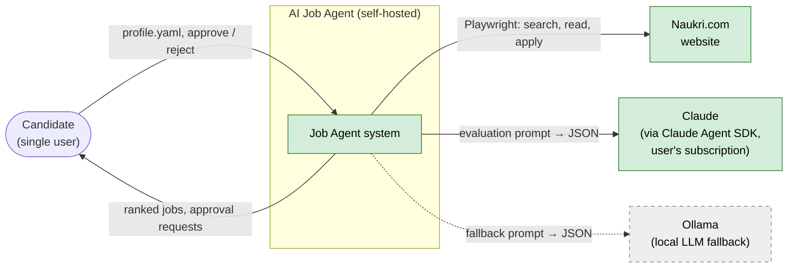
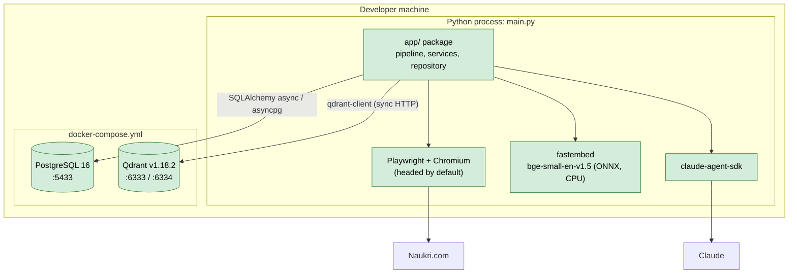
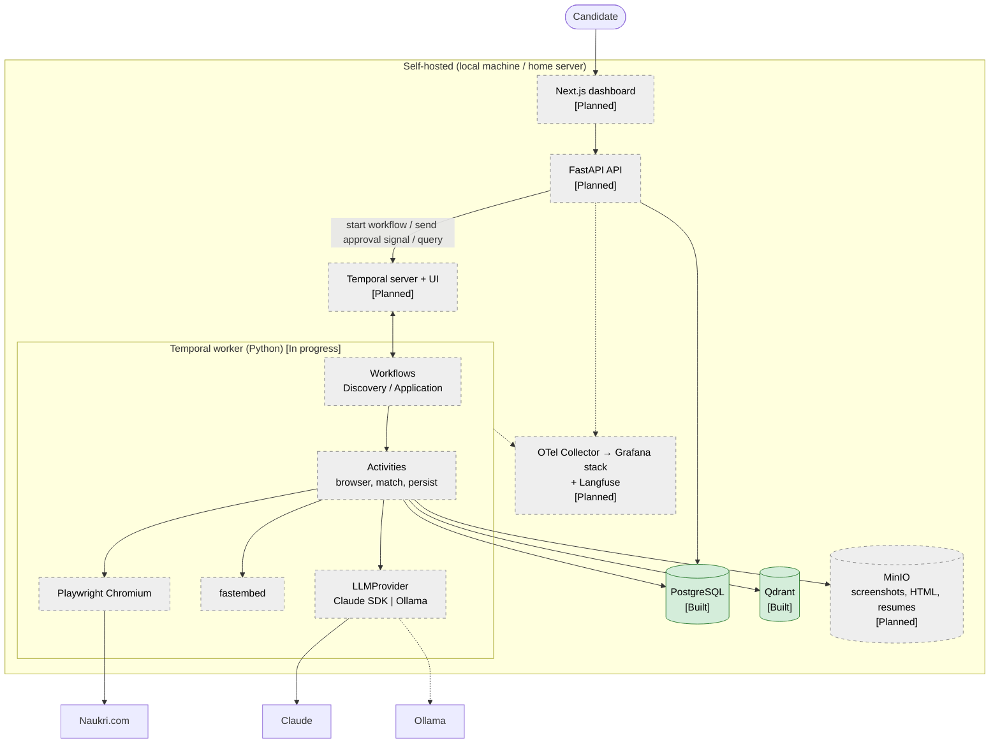
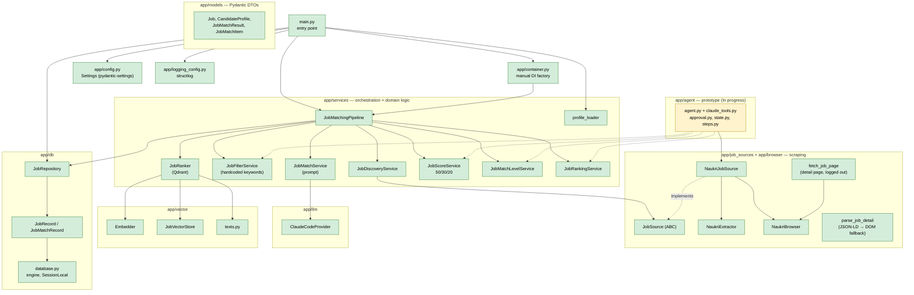

# 02 — Architecture

C4-style views drawn as Mermaid flowcharts. Solid green = **Built**, yellow = **In progress**,
dashed grey = **Planned**.

## 1. System context

## 2. Containers — current (Built)

Everything runs in one Python process started by `python main.py`; Postgres and Qdrant run in
Docker Compose.

Also in the repo but outside the main flow:

- `app/agent/` — **In progress**: Claude Agent SDK tool-calling prototype with a CLI approval prompt
  (`python -m app.agent.agent`). Duplicates part of the pipeline ([known issue](12-roadmap-and-status.md#known-issues)).
- `server.py` — an unrelated MCP-server experiment (`create_post` tool). Not part of the product.

## 3. Containers — target (Planned)

Key properties of the target:

- **One codebase, two entry points** (API + worker) — modular monolith ([ADR-011](adr/ADR-011-modular-monolith.md)).
- **The browser runs where the user is.** Headed Chromium needs a display, so the worker runs on
  the user's machine, not in a headless container, unless `BROWSER_HEADLESS=true`.
- **Approval is a Temporal signal** sent by the API; the submit activity is unreachable without it ([03](03-workflows.md)).
- **Postgres is the source of truth**; Qdrant and MinIO hold derived / binary data and can be rebuilt or re-captured.

## 4. Components of `app/` (current)

### Layer responsibilities

| Layer | Package | Responsibility | Status |
|---|---|---|---|
| Entry / composition | `main.py`, `app/container.py` | Load settings + profile, wire dependencies, print result | Built |
| Orchestration | `app/services/job_matching_pipeline.py` | Run the steps in order | Built (to be replaced by Temporal workflows) |
| Domain services | `app/services/*` | Filtering, scoring, levelling, ranking, prompt building | Built |
| Sources / browser | `app/job_sources/`, `app/browser/` | Get jobs from Naukri | Built (search cards; detail pages via the `fetch_job_details` activity on the `job-agent-browser` queue) |
| LLM | `app/llm/` | Call Claude and validate JSON | Built (no abstraction yet) |
| Retrieval | `app/vector/` | Embeddings + Qdrant | Built |
| Persistence | `app/db/`, `alembic/` | Tables, repository, migrations | Built |
| DTOs | `app/models/` | Pydantic models passed between layers | Built |
| API / UI | — | FastAPI, Next.js | Planned |
| Workflows | `app/workflows/` | Temporal workflows, activities, worker, client (Pydantic converter) | In progress (discovery + per-job application with approval; apply is dry-run) |

### Dependency rules (to keep as the code grows)

- `app/models` depends on nothing inside `app/`.
- Domain services must not import Playwright, SQLAlchemy, Qdrant or an LLM SDK directly; they get
  them through an interface (`JobSource`, `LLMProvider`, repository). *Currently violated by
  `JobMatchService`, which instantiates `ClaudeCodeProvider` itself (`app/services/job_match_service.py:11`).*
- Temporal workflow code must be deterministic: no I/O, no `datetime.now()`, no randomness
  — all of that lives in activities.

## 5. Current vs target — summary

| Concern | Current | Target |
|---|---|---|
| Trigger | Manual `python main.py` | Temporal Schedule → `JobDiscoveryWorkflow` |
| Orchestration | `JobMatchingPipeline.run()` in-process | Temporal workflows + activities |
| Job detail | Workflow path: detail page read after the filter (`jobs.description_full`, `jobs.details`); `main.py` path: snippet unless details were already stored | Same, plus a backfill for older jobs |
| Job state | Implicit (row in `jobs` / row in `job_matches`) | Explicit lifecycle state machine ([03](03-workflows.md#job-lifecycle-state-machine)) |
| LLM | `ClaudeCodeProvider` called directly, sequential | `LLMProvider` interface, timeouts, retries, bounded concurrency |
| Approval | CLI `input()` in prototype | Signal from dashboard/API with timeout |
| Apply | Not implemented | `submit_application` activity, dry-run first |
| Users | Single, implicit | `users` + `candidate_profiles` tables |
| Artifacts | None | MinIO (screenshots, page HTML) |
| Observability | structlog to stdout | OpenTelemetry + Grafana stack + Langfuse |
