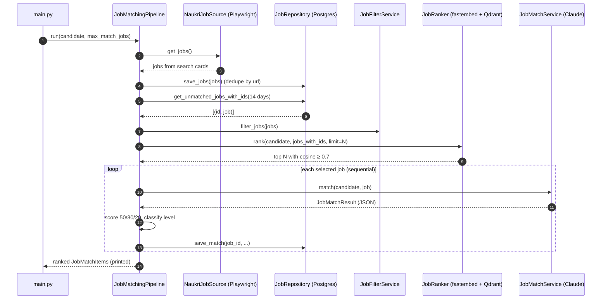
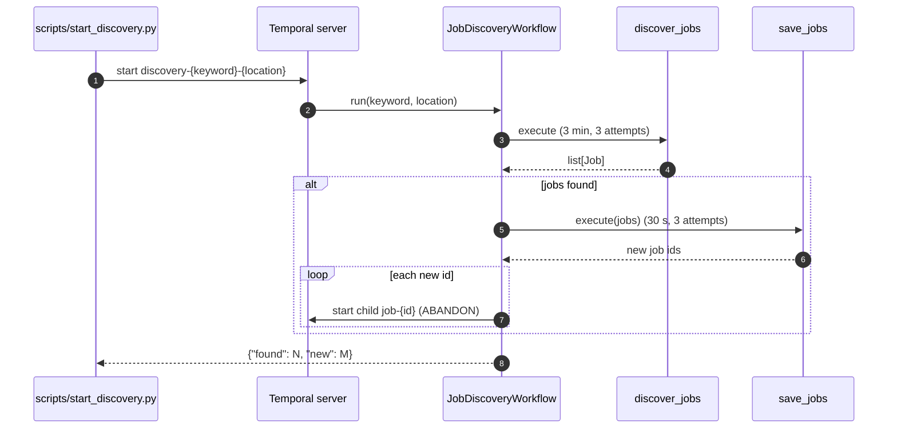
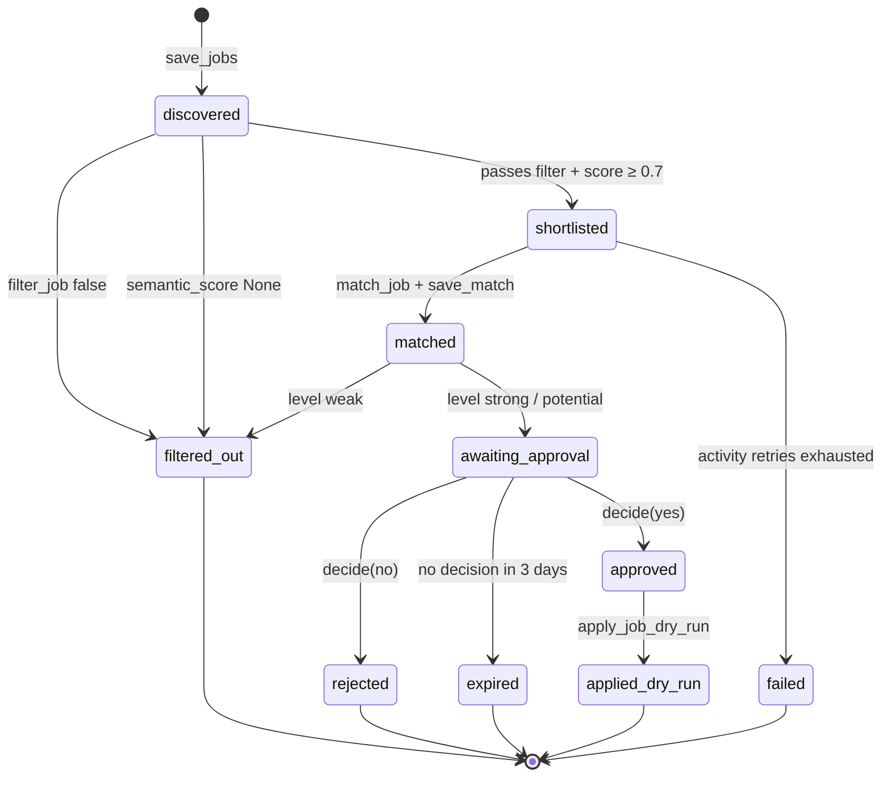
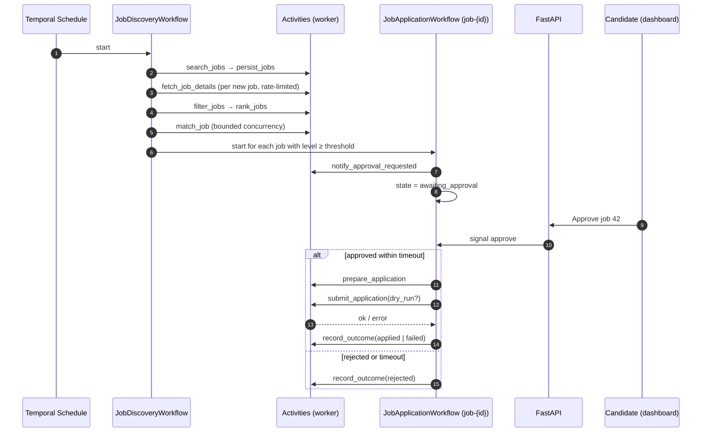
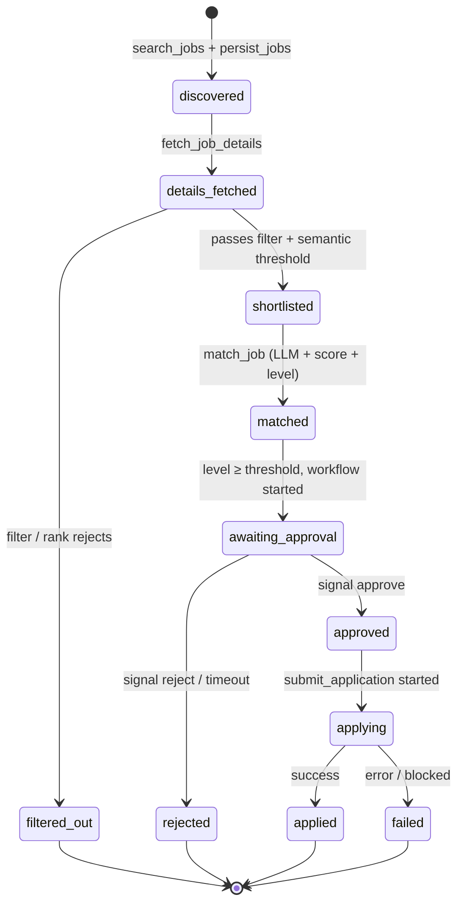

# 03 — Workflows

> **Status: In progress.** On Temporal today: `JobDiscoveryWorkflow` (search + save, starts one child
> per new job) and `JobApplicationWorkflow` (evaluate → human approval → **dry-run** apply) — see
> [Discovery workflow](#discovery-workflow-built) and [Application workflow](#application-workflow-built-dry-run).
> Sections from [Target workflows](#target-workflows) on are the remaining design.
> [Current flow](#current-flow-built) describes the older all-in-one pipeline in `main.py`.

## Current flow (Built)

`main.py` → `JobMatchingPipeline.run()` (`app/services/job_matching_pipeline.py:38`), one process,
no retries, no persistence of intermediate state beyond `jobs` and `job_matches`.

## Discovery workflow (Built)

`app/workflows/` — finds and stores jobs, then hands each **new** job to its own
[application workflow](#application-workflow-built-dry-run).

| Piece | File | What it does |
|---|---|---|
| `JobDiscoveryWorkflow.run(keyword, location)` | `job_discovery_workflow.py` | Calls `discover_jobs`, then `save_jobs` (skipped if nothing found), then starts one child `JobApplicationWorkflow` (id `job-{id}`, `ParentClosePolicy.ABANDON`) per new job id. Returns `{"found": N, "new": M}`. |
| `discover_jobs(keyword, location) -> list[Job]` | `activities.py` | Wraps `NaukriJobSource.get_jobs`. start-to-close **3 min**. |
| `save_jobs(jobs) -> list[int]` | `activities.py` | Own `SessionLocal` session; `JobRepository.save_jobs(source="naukri")` + `get_ids_by_urls`; returns the ids of the new jobs. start-to-close **30 s**. |
| Client | `client.py` | `connect_client()` — the only way to connect; always uses `pydantic_data_converter`. |
| Worker | `worker.py` | Registers both workflows + all activities on `TEMPORAL_TASK_QUEUE`, `max_concurrent_activities=3` (caps parallel LLM / browser work); logs `worker_started`. |
| Starter | `scripts/start_discovery.py` | Starts the workflow with ID `discovery-{keyword}-{location}` (slugified), waits, prints the result. |

- **Retry policy** (all activities, `app/workflows/retry.py`): max 3 attempts, initial interval 10 s, backoff 2.0.
- **Payloads are our Pydantic models** (`Job`, `JobMatchItem`, `JobStatus`) via
  `temporalio.contrib.pydantic.pydantic_data_converter`. Worker, scripts and tests must all use it.
- **ABANDON** lets discovery complete while its children keep waiting (up to 3 days) for approval.
- **Determinism:** activities are imported inside `workflow.unsafe.imports_passed_through()`; all
  browser and DB I/O stays in activities.
- **Workflow ID** is stable per search, so a second start while one is running fails with
  `WorkflowAlreadyStartedError` (the script prints a message). A finished run can be started again.
- **Tests:** `tests/workflows/test_job_discovery_workflow.py` uses `WorkflowEnvironment.start_time_skipping()`
  with fake activities registered under the real names and a stub child workflow (no browser, no DB).
- **Known gap:** if `save_jobs` commits but the activity fails before returning, the retry sees those
  jobs as "already seen" and no child is started for them; start them with `scripts/start_job_workflow.py`.

## Application workflow (Built, dry-run)

`JobApplicationWorkflow.run(job_id) -> str` in `app/workflows/job_application_workflow.py`,
workflow id **`job-{job_id}`**. Started by discovery (child) or `scripts/start_job_workflow.py`.
Returns the final status. **Apply is DRY-RUN only**: `apply_job_dry_run` logs what it would do.

| Activity | Reuses | Timeout | Result |
|---|---|---|---|
| `load_job(job_id)` | `JobRepository.get_job` | 30 s | `Job` |
| `filter_job(job)` | `JobFilterService.filter_jobs` | 30 s | `bool` |
| `semantic_score(job_id, job)` | `JobRanker.rank(..., limit=1)` (run in a thread; embedder cached per worker) | 1 min | `float`, or `None` below `MIN_SCORE` 0.7 |
| `match_job(job)` | `JobMatchService` + `JobScoreService` + `JobMatchLevelService` | 2 min | `JobMatchItem` |
| `save_match(job_id, item)` | `JobRepository.save_match` (upsert) | 30 s | — |
| `update_job_status(job_id, status)` | `JobRepository.update_status` | 30 s | — |
| `apply_job_dry_run(job_id)` | `JobRepository.get_job`, logs `apply_dry_run` | 30 s | message |

All use the shared retry policy (max 3 attempts). The profile is loaded inside activities from
`settings.PROFILE_PATH` on every call.

- **Signal** `decide(approved: bool, note: str = "")`. Ignored (logged) unless the status is
  `awaiting_approval` and no decision was made yet, so nothing is approved early.
- **Query** `current_status() -> str`.
- **Approval timeout: 3 days** (`workflow.wait_condition`). On timeout → `expired`. Silence never means yes.
- Only `strong` and `potential` matches wait for approval; `weak` ends as `filtered_out`.
- Every status change goes through the `update_job_status` activity; the workflow keeps only an
  in-memory copy for the query.
- If an activity gives up after its retries, the workflow sets `failed` and then fails (visible in the UI).
- **Scripts:** `scripts/list_pending.py` (jobs in `awaiting_approval` with LLM score + level),
  `scripts/decide_job.py <job_id> yes|no [note]` (checks status via the query, then signals),
  `scripts/start_job_workflow.py <job_id>` (for jobs saved before workflows existed).
- **Tests:** `tests/workflows/test_job_application_workflow.py` — approved, rejected,
  3-day timeout → expired, weak → filtered_out (time-skipping server, fake activities).

## Target workflows

| Workflow | Workflow ID | Started by | Purpose |
|---|---|---|---|
| `JobDiscoveryWorkflow` | `discovery-{user_id}-{scheduled_time}` | Temporal Schedule (e.g. twice a day) or API "run now" | Find, store, filter, rank and evaluate new jobs; start application workflows for good matches. |
| `JobApplicationWorkflow` | **`job-{job_id}`** | `JobDiscoveryWorkflow` (child or via client start) | Take one matched job through approval and (optionally) submission. |

Using `job-{job_id}` as the workflow ID makes the application flow **idempotent per job**: starting
it twice fails with "already started", so a job can never get two parallel application flows.
Use `WorkflowIDReusePolicy.REJECT_DUPLICATE` so a finished job is never re-applied automatically.
(Becomes `job-{user_id}-{job_id}` in the multi-user phase.)

## Activities

| Activity | Used by | Maps to current code | Retry policy | Notes |
|---|---|---|---|---|
| `search_jobs(keyword, location)` | Discovery | `NaukriJobSource.get_jobs` | 3 attempts, backoff 30 s → 5 min | Heartbeat per page. |
| `persist_jobs(jobs)` | Discovery | `JobRepository.save_jobs` | default | Idempotent (URL unique). |
| `fetch_job_details(job_id)` | Discovery | — (planned) | 3 attempts | Rate-limited; sets `details_fetched`. |
| `filter_jobs(job_ids)` | Discovery | `JobFilterService.filter_jobs` | default | Sets `filtered_out` / `shortlisted`. Profile-driven keywords. |
| `rank_jobs(job_ids, limit)` | Discovery | `JobRanker.rank` | default | Runs embedding in a thread. |
| `match_job(job_id)` | Discovery | `JobMatchService.match` + score + level + `save_match` | 3 attempts, start-to-close 120 s | LLM call; validated JSON; sets `matched`. |
| `notify_approval_requested(job_id)` | Application | — | default | Dashboard notification (later: email / push). |
| `prepare_application(job_id)` | Application | — | default | Collect answers, choose resume, store preview. |
| `submit_application(job_id, dry_run)` | Application | — | **maximum_attempts = 1** | Not idempotent on Naukri's side — never auto-retry. Screenshots before/after to MinIO. |
| `record_outcome(job_id, status, error)` | Both | — | default | Updates `applications` / job status. |

Workflow code only calls activities, timers and signals; all I/O is in activities.

## Approval via signal

- Signals: `approve(approved_by, note)`, `reject(reason)`.
- Query: `get_state()` → current status, match summary, deadline.
- Timeout: `await workflow.wait_condition(lambda: decision is not None, timeout=APPROVAL_TIMEOUT)`.
  - **Built:** `APPROVAL_TIMEOUT` = 3 days; on timeout the job moves to `expired`. Silence never means yes.
- The API sends the signal by workflow ID `job-{job_id}` after authenticating the user.
- The approval decision (who, when, note) is written to `applications` before `submit_application`
  is scheduled. `submit_application` asserts that record exists.

### Dry-run mode

`submit_application(dry_run=True)` performs every step up to — but not including — the final
submit click, captures screenshots, and records `applied_dry_run` in `applications.dry_run`.
Dry-run is the **default** until the apply flow has been validated manually ([06](06-browser-automation.md#dry-run-mode-planned)).

## Job lifecycle state machine

| State | Meaning | Stored as (planned) | Exists today? |
|---|---|---|---|
| `discovered` | Row in `jobs` from a search card | `jobs.status` | Yes (default) |
| `details_fetched` | Detail page scraped, full description saved | `jobs.status` | No |
| `filtered_out` | Failed keyword filter, semantic threshold, or `weak` LLM level | `jobs.status` | Yes (workflow path; `main.py` still re-processes) |
| `shortlisted` | Selected for LLM evaluation | `jobs.status` | Yes (workflow path) |
| `matched` | LLM result + score saved | `jobs.status` + `job_matches` row | Yes (workflow path; migration backfilled old matches) |
| `awaiting_approval` | Application workflow waiting for signal | `jobs.status` today (`applications.status` planned) | Yes |
| `approved` / `rejected` / `expired` | Human decision, or 3-day timeout | `jobs.status` today (`applications.status` planned) | Yes (note is not persisted yet) |
| `applied_dry_run` | Dry-run apply logged | `jobs.status` | Yes |
| `applying` / `applied` / `failed` | Submission in progress / done / errored | `applications.status` | No |

Rules:

- Transitions happen only inside activities, in the same DB transaction as the data they describe.
- `matched` jobs below the approval threshold stay in `matched` and are not surfaced (open question:
  add an explicit `not_recommended` terminal state?).
- `failed` is terminal for automation; a retry is a new human decision (open question).
- `last_seen_at` refresh does not change state.
