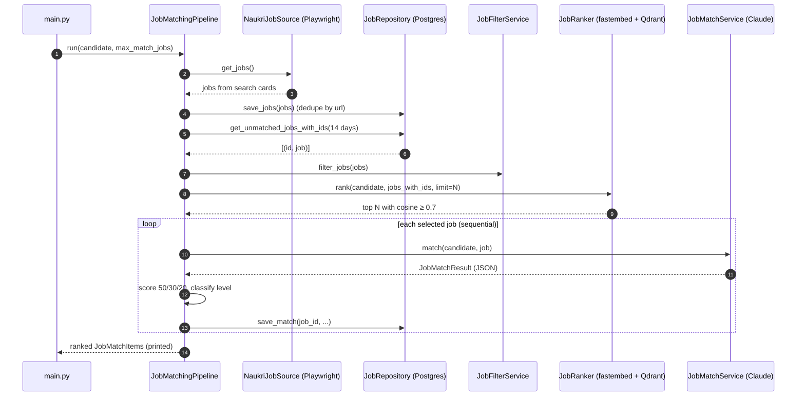
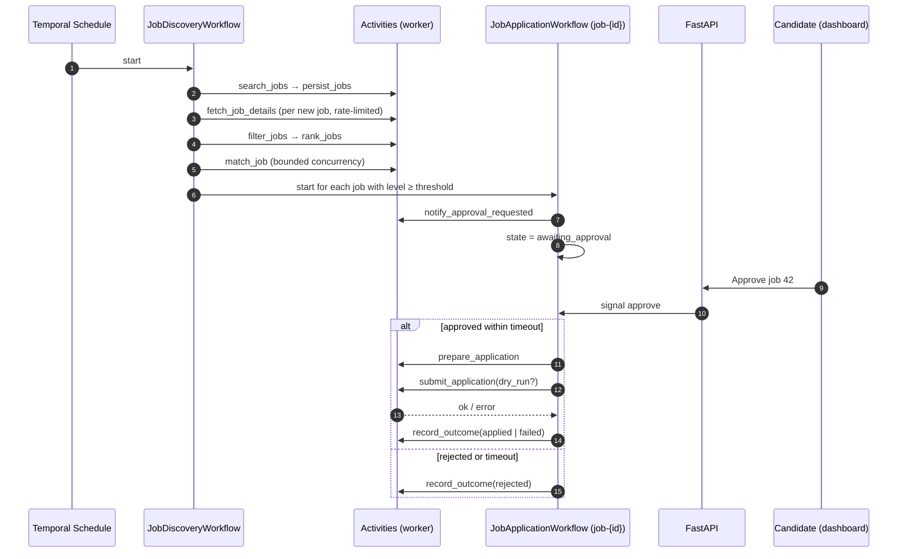
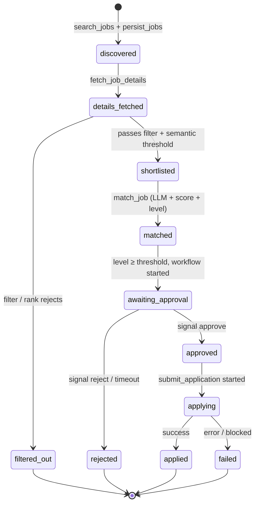

# 03 — Workflows

> **Status: Planned.** No Temporal code exists yet. This document is the design the implementation
> must follow. Section [Current flow](#current-flow-built) describes what runs today.

## Current flow (Built)

`main.py` → `JobMatchingPipeline.run()` (`app/services/job_matching_pipeline.py:38`), one process,
no retries, no persistence of intermediate state beyond `jobs` and `job_matches`.

## Target workflows

| Workflow | Workflow ID | Started by | Purpose |
|---|---|---|---|
| `JobDiscoveryWorkflow` | `discovery-{user_id}-{scheduled_time}` | Temporal Schedule (e.g. twice a day) or API "run now" | Find, store, filter, rank and evaluate new jobs; start application workflows for good matches. |
| `JobApplicationWorkflow` | **`job-{job_id}`** | `JobDiscoveryWorkflow` (child or via client start) | Take one matched job through approval and (optionally) submission. |

Using `job-{job_id}` as the workflow ID makes the application flow **idempotent per job**: starting
it twice fails with "already started", so a job can never get two parallel application flows.
Use `WorkflowIDReusePolicy.REJECT_DUPLICATE` so a finished job is never re-applied automatically.
(Becomes `job-{user_id}-{job_id}` in the multi-user phase.)

## Activities

| Activity | Used by | Maps to current code | Retry policy | Notes |
|---|---|---|---|---|
| `search_jobs(keyword, location)` | Discovery | `NaukriJobSource.get_jobs` | 3 attempts, backoff 30 s → 5 min | Heartbeat per page. |
| `persist_jobs(jobs)` | Discovery | `JobRepository.save_jobs` | default | Idempotent (URL unique). |
| `fetch_job_details(job_id)` | Discovery | — (planned) | 3 attempts | Rate-limited; sets `details_fetched`. |
| `filter_jobs(job_ids)` | Discovery | `JobFilterService.filter_jobs` | default | Sets `filtered_out` / `shortlisted`. Profile-driven keywords. |
| `rank_jobs(job_ids, limit)` | Discovery | `JobRanker.rank` | default | Runs embedding in a thread. |
| `match_job(job_id)` | Discovery | `JobMatchService.match` + score + level + `save_match` | 3 attempts, start-to-close 120 s | LLM call; validated JSON; sets `matched`. |
| `notify_approval_requested(job_id)` | Application | — | default | Dashboard notification (later: email / push). |
| `prepare_application(job_id)` | Application | — | default | Collect answers, choose resume, store preview. |
| `submit_application(job_id, dry_run)` | Application | — | **maximum_attempts = 1** | Not idempotent on Naukri's side — never auto-retry. Screenshots before/after to MinIO. |
| `record_outcome(job_id, status, error)` | Both | — | default | Updates `applications` / job status. |

Workflow code only calls activities, timers and signals; all I/O is in activities.

## Approval via signal

- Signals: `approve(approved_by, note)`, `reject(reason)`.
- Query: `get_state()` → current status, match summary, deadline.
- Timeout: `await workflow.wait_condition(lambda: decision is not None, timeout=APPROVAL_TIMEOUT)`.
  - **`APPROVAL_TIMEOUT` = 72 h — placeholder, to be decided** ([open question](12-roadmap-and-status.md#open-questions)).
  - On timeout the job moves to `rejected` with `reason = "approval_timeout"`. Silence never means yes.
- The API sends the signal by workflow ID `job-{job_id}` after authenticating the user.
- The approval decision (who, when, note) is written to `applications` before `submit_application`
  is scheduled. `submit_application` asserts that record exists.

### Dry-run mode

`submit_application(dry_run=True)` performs every step up to — but not including — the final
submit click, captures screenshots, and records `applied_dry_run` in `applications.dry_run`.
Dry-run is the **default** until the apply flow has been validated manually ([06](06-browser-automation.md#dry-run-mode-planned)).

## Job lifecycle state machine

| State | Meaning | Stored as (planned) | Exists today? |
|---|---|---|---|
| `discovered` | Row in `jobs` from a search card | `jobs.status` | Implicit (any `jobs` row) |
| `details_fetched` | Detail page scraped, full description saved | `jobs.status` | No |
| `filtered_out` | Failed keyword filter or semantic threshold | `jobs.status` | **No — these jobs are re-processed every run** |
| `shortlisted` | Selected for LLM evaluation | `jobs.status` | No |
| `matched` | LLM result + score saved | `jobs.status` + `job_matches` row | Implicit (`job_matches` row) |
| `awaiting_approval` | Application workflow waiting for signal | `applications.status` | No |
| `approved` / `rejected` | Human decision (or timeout) recorded | `applications.status` | No (CLI prototype only, not persisted) |
| `applying` / `applied` / `failed` | Submission in progress / done / errored | `applications.status` | No |

Rules:

- Transitions happen only inside activities, in the same DB transaction as the data they describe.
- `matched` jobs below the approval threshold stay in `matched` and are not surfaced (open question:
  add an explicit `not_recommended` terminal state?).
- `failed` is terminal for automation; a retry is a new human decision (open question).
- `last_seen_at` refresh does not change state.
