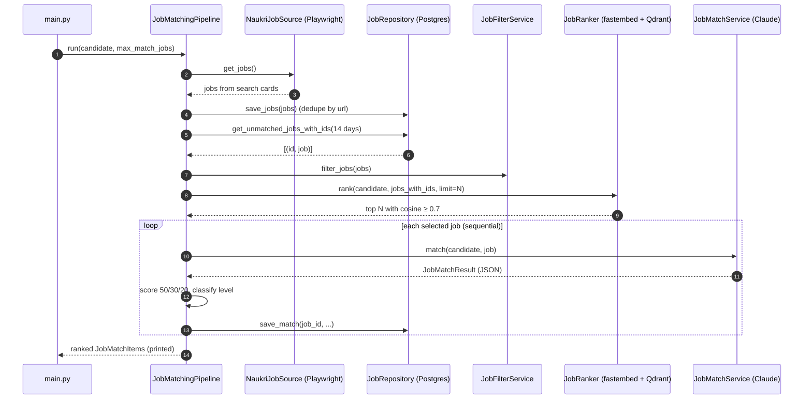
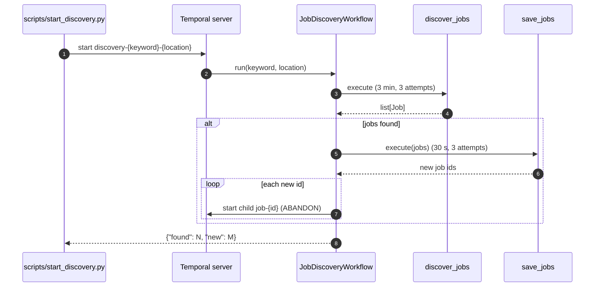
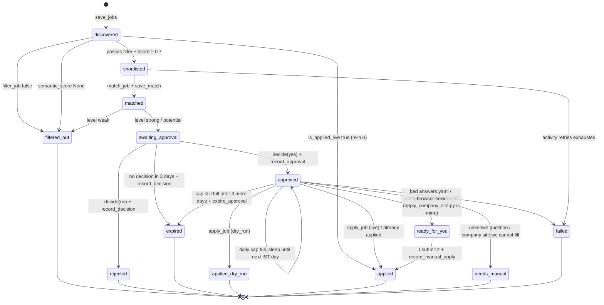
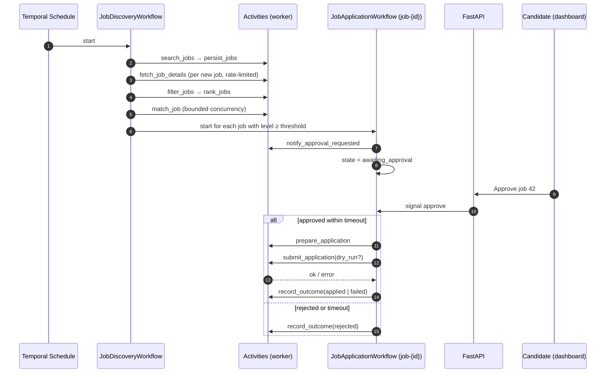
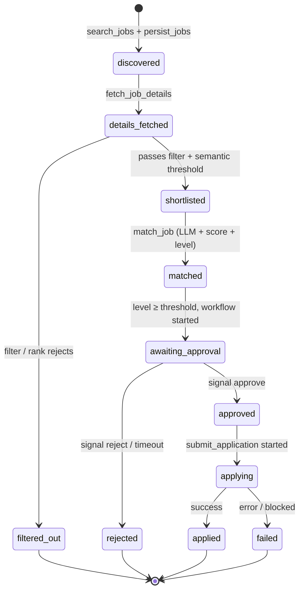

# 03 — Workflows

> **Status: In progress.** On Temporal today: `JobDiscoveryWorkflow` (search + save, starts one child
> per new job) and `JobApplicationWorkflow` (evaluate → human approval → apply behind safety rails,
> **dry-run by default**) — see [Discovery workflow](#discovery-workflow-built) and
> [Application workflow](#application-workflow-built-dry-run).
> Sections from [Target workflows](#target-workflows) on are the remaining design.
> [Current flow](#current-flow-built) describes the older all-in-one pipeline in `main.py`.

## Current flow (Built)

`main.py` → `JobMatchingPipeline.run()` (`app/services/job_matching_pipeline.py:38`), one process,
no retries, no persistence of intermediate state beyond `jobs` and `job_matches`.

## Discovery workflow (Built)

`app/workflows/` — finds and stores jobs, then hands each **new** job to its own
[application workflow](#application-workflow-built-dry-run).

| Piece | File | What it does |
|---|---|---|
| `JobDiscoveryWorkflow.run(keyword, location)` | `job_discovery_workflow.py` | Calls `discover_jobs`, then `save_jobs` (skipped if nothing found), then starts one child `JobApplicationWorkflow` (id `job-{id}`, `ParentClosePolicy.ABANDON`) per new job id. Returns `{"found": N, "new": M}`. |
| `discover_jobs(keyword, location) -> list[Job]` | `activities.py` | Wraps `NaukriJobSource.get_jobs`. start-to-close **3 min**. |
| `save_jobs(jobs) -> list[int]` | `activities.py` | Own `SessionLocal` session; `JobRepository.save_jobs(source="naukri")` + `get_ids_by_urls`; returns the ids of the new jobs. start-to-close **30 s**. |
| Client | `client.py` | `connect_client()` — the only way to connect; always uses `pydantic_data_converter`. |
| Worker | `worker.py` | Registers both workflows + all activities on `TEMPORAL_TASK_QUEUE`, `max_concurrent_activities=3` (caps parallel LLM / browser work). A second `Worker` in the same process serves `fetch_job_details` on `BROWSER_TASK_QUEUE` (`job-agent-browser`, `app/workflows/task_queues.py`) with `max_concurrent_activities=1`: one detail page at a time, and waiting tasks stay on the server instead of holding a main-queue slot. Logs `worker_started` with `apply_mode`, `max_applies_per_day`, `browser_task_queue`, `detail_page_delay_seconds` and `detail_page_jitter_seconds`, so the log shows which safety rails the running worker uses. |
| Starter | `scripts/start_discovery.py` | Starts the workflow with ID `discovery-{keyword}-{location}` (slugified), waits, prints the result. |

- **Retry policy** (all activities, `app/workflows/retry.py`): max 3 attempts, initial interval 10 s, backoff 2.0.
- **Payloads are our Pydantic models** (`Job`, `JobMatchItem`, `JobStatus`) via
  `temporalio.contrib.pydantic.pydantic_data_converter`. Worker, scripts and tests must all use it.
- **ABANDON** lets discovery complete while its children keep waiting (up to 3 days) for approval.
- **Determinism:** activities are imported inside `workflow.unsafe.imports_passed_through()`; all
  browser and DB I/O stays in activities.
- **Workflow ID** is stable per search, so a second start while one is running fails with
  `WorkflowAlreadyStartedError` (the script prints a message). A finished run can be started again.
- **Tests:** `tests/workflows/test_job_discovery_workflow.py` uses `WorkflowEnvironment.start_time_skipping()`
  with fake activities registered under the real names and a stub child workflow (no browser, no DB).
- **Known gap:** if `save_jobs` commits but the activity fails before returning, the retry sees those
  jobs as "already seen" and no child is started for them; start them with `scripts/start_job_workflow.py`.

## Application workflow (Built, dry-run)

`JobApplicationWorkflow.run(job_id) -> str` in `app/workflows/job_application_workflow.py`,
workflow id **`job-{job_id}`**. Started by discovery (child) or `scripts/start_job_workflow.py`.
Returns the final status. Apply runs through `apply_job` and its [safety rails](#apply-safety-rails-built).
`APPLY_MODE=dry_run` is the default; live browser apply is built but its chatbot selectors are not
yet verified ([06](06-browser-automation.md#live-apply-built-chatbot-selectors-not-verified)).

| Activity | Reuses | Timeout | Result |
|---|---|---|---|
| `is_applied_live(job_id)` | `JobRepository.is_applied_live` (reads `applications`) | 30 s | `bool` |
| `load_job(job_id)` | `JobRepository.get_job` | 30 s | `Job` |
| `filter_job(job)` | `JobFilterService.filter_jobs` | 30 s | `bool` |
| `fetch_job_details(job_id)` | `fetch_job_page` + `parse_job_detail` + `JobRepository.save_details` ([06](06-browser-automation.md#job-detail-page-built)); runs on `job-agent-browser`; sleeps `DETAIL_PAGE_DELAY_SECONDS` + `random.uniform(0, DETAIL_PAGE_JITTER_SECONDS)` first; skips the request if `details` is already stored | 2 min start-to-close, **30 min schedule-to-close** (queue wait + all attempts) | `Job` with the full JD; parse failure → non-retryable `DetailParseError` |
| `semantic_score(job_id, job)` | `JobRanker.rank(..., limit=1)` (run in a thread; embedder cached per worker) | 1 min | `float`, or `None` below `MIN_SCORE` 0.7 |
| `match_job(job)` | `JobMatchService` + `JobScoreService` + `JobMatchLevelService` | 2 min | `JobMatchItem` |
| `save_match(job_id, item)` | `JobRepository.save_match` (upsert) | 30 s | — |
| `update_job_status(job_id, status)` | `JobRepository.update_status` (refused + `job_status_update_refused` warning for a job applied live, unless the status is `applied`) | 30 s | — |
| `record_approval(job_id, approved_at, note)` | `JobRepository.record_approval`: `applications` row `pending` + `job_decisions` row `approved` + `jobs.status=approved`, one commit; leaves a job applied live untouched | 30 s | — |
| `record_decision(job_id, decision, decided_at, note)` | `JobRepository.record_decision`: `job_decisions` row (`rejected` / `expired`) + `jobs.status`, one commit | 30 s | — |
| `apply_job(job_id)` | `ApplyService` (`app/services/apply_service.py`) | 5 min | `ApplyResult` |
| `expire_approval(job_id, reason)` | `JobRepository.expire_approval`: `applications` `pending` → `expired` + reason + `jobs.status=expired`, one commit; any other outcome is left untouched | 30 s | — |

All except `apply_job` use the shared retry policy (max 3 attempts). `apply_job` uses
`APPLY_RETRY_POLICY` (**1 attempt**): retrying a half-finished apply could apply twice. The profile is loaded inside activities from
`settings.PROFILE_PATH` on every call.

- **Signal** `decide(approved: bool, note: str = "")`. Ignored (logged) unless the status is
  `awaiting_approval` and no decision was made yet, so nothing is approved early.
- **Query** `current_status() -> str`.
- **Already applied live → stop.** The first step is `is_applied_live`: if `applications` has a live
  `applied` row, the workflow returns `applied` at once (no `load_job`, no LLM, no status write, no
  approval prompt). Protects re-runs, e.g. `scripts/start_job_workflow.py` on an applied job.
- **Approval timeout: 3 days** (`workflow.wait_condition`). On timeout → `expired`, logged by
  `record_decision` with `decided_at = workflow.now()` at the timeout. Silence never means yes.
- Only `strong` and `potential` matches wait for approval; `weak` ends as `filtered_out`.
- Every status change goes through an activity (`update_job_status`, `record_approval`, `apply_job`);
  the workflow keeps only an in-memory copy for the query.
- **Approval is recorded** by `record_approval` with the note and the decision time. The time is
  `workflow.now()` taken in the signal handler: deterministic on replay, and the real decision time
  even if the activity runs later. A rejection is logged by `record_decision` (note + decision time)
  in `job_decisions`, never in `applications` (a row there means "approved").
- **Run id:** `record_approval` / `record_decision` read `activity.info().workflow_run_id` and store
  it as the `job_decisions` idempotency key, so a retried activity logs the decision once.
- **Full JD before scoring.** After `filter_job` (which reads only title + skills, so filtered-out
  jobs cost no page request) the workflow runs `fetch_job_details` and passes the returned `Job` to
  `semantic_score` and `match_job`. If it fails (parse error, 3 failed attempts, or the 30-min
  deadline, e.g. no browser worker), the workflow logs a warning and **continues with the card
  snippet**; the job is not failed and `jobs.details_fetched_at` stays NULL.
- If any other activity gives up after its retries, the workflow sets `failed` and then fails (visible in the UI).
- **Scripts:** `scripts/list_pending.py` (jobs in `awaiting_approval` with LLM score + level, then
  `needs_manual` / `failed` jobs with their reason), `scripts/mark_applied.py <job_id> --reason`
  (records an apply done by hand),
  `scripts/decide_job.py <job_id> yes|no [note]` (checks status via the query, then signals),
  `scripts/start_job_workflow.py <job_id>` (for jobs saved before workflows existed),
  `scripts/replay_open_runs.py` (replays every open `JobApplicationWorkflow` with this checkout's
  code and prints its patch markers; exit 1 if any fails — run before and after a workflow deploy).
- **Tests:** `tests/workflows/test_job_application_workflow.py` — approved, rejected,
  3-day timeout → expired, weak → filtered_out, needs_manual, cap wait + retry, cap → expired after
  3 days (via `expire_approval`, no `update_job_status(expired)`), every file in `histories/` replays, `record_approval` gets the note and decision time (and is not called on reject),
  `record_decision` gets the rejection note/time and the timeout time, an already-applied job never
  reaches `load_job` / `match_job`, histories in `histories/retired/` (pre-patch or with
  non-deprecated `apply-job-v1` / `record-approval-v1` markers) must fail to replay, a history with
  deprecated markers (`deprecated_markers_v1.json`) replays without the calls, and replay of the
  pre-`record-decision-v1` and current histories, plus a real one (`awaiting_approval_v1.json`,
  job-37 waiting for approval before `fetch-details-v1`) from the local
  server; the full JD reaches `semantic_score` and `match_job`, a broken detail page falls back to
  the snippet, a filtered-out job reads no page, and `fetch_job_details` is scheduled on the browser
  queue with the 30-min deadline (time-skipping server, fake activities). Activity:
  `tests/workflows/test_fetch_job_details_activity.py` (fixture page, skip if fetched, non-retryable
  parse error).

A company-site job ends the workflow at `ready_for_you`. The rest happens outside Temporal: I
run `scripts/apply_company_site.py`. No workflow can wait for me to solve a CAPTCHA. The workflow
only mirrors the new outcome in `_final_status` (a query value, no new command), so it needs no
`workflow.patched`. `tests/workflows/histories/ready_for_you_v2.json` (recorded from this code)
replays in `test_ready_for_you_history_replays`.

### Apply safety rails (Built)

`ApplyService.apply(job_id)` (called by the `apply_job` activity) runs these checks in order:

1. **Lock** — `JobRepository.lock_applies()` takes a Postgres advisory transaction lock
   (`pg_advisory_xact_lock`). It is held until the final result is committed, so two parallel
   activities cannot both pass the cap check ("check-then-act" race).
2. **Approval** — no `applications` row → `NotApprovedError` (the activity fails; nothing is opened).
3. **Idempotency** — from `applications`, not `jobs.status`: row applied live → `already_applied`,
   and `jobs.status` is synced back to `applied`. `jobs.status` alone could not be trusted: the
   workflow writes `approved` before every apply, so a re-run workflow (or a manual apply while it
   waited) used to wipe `applied` and the job was applied again.
   3b. **Company site already opened**: a `ready_for_you` row is returned as is, with no browser.
   If `jobs.company_site_opened_at` is set (by the worker or the inspector), Naukri now says
   "Applied" because of our click (issue #18), so Naukri is never asked again. The applier gets
   `company_site_url` and checks that page directly. If the URL is unknown, the result is
   `needs_manual`. A false `applied` is never recorded.
4. **Daily cap** — counts `applications` rows applied (live, or dry run in dry-run mode) since the
   start of the **IST day**, plus company-site clicks on their day. At `MAX_APPLIES_PER_DAY` → `skipped_cap` with `retry_after_seconds`
   until IST midnight; the row stays `pending`. Dry runs never use up the live quota.
5. **Answers** — `answers.yaml` is loaded and validated in both modes; missing / invalid → `failed`.
6. **Apply** — `APPLY_MODE=dry_run`: logs only; the browser applier is never even built.
   `live`: `NaukriJobApplier.apply(job_id, job, answers)` (`app/browser/job_applier.py`) →
   `ApplierResult` `applied` / `needs_manual` / `already_applied` / `ready_for_you` with a `reason`
   (e.g. the unknown question, or the fill command) copied into `ApplyResult.reason`, plus
   `company_site` (URL, portal, human steps) saved on the row. The applier gets an
   `on_company_site_click` hook (`mark_company_site_opened`), which runs right before the click; any exception (incl. expired session, apply not
   confirmed) → `failed`. The lock stays held during the browser apply (minutes), which is fine
   with one apply at a time.

`ApplyResult` (`app/models/apply_result.py`): `outcome` (`applied`, `needs_manual`, `failed`,
`skipped_cap`, `already_applied`, `ready_for_you`), `dry_run`, `reason`, `retry_after_seconds`.

The activity writes the result itself with `JobRepository.save_apply_result`: `applications`
(`outcome`, `reason`, `dry_run`, `applied_at`, `artifacts_dir` = `artifacts/apply/<job_id>`) **and**
`jobs.status` in one commit inside the lock, so both change or neither does. The update refuses a row
already applied live (`ApplicationNotWritableError`), a DB-level backstop to step 3. The workflow only
mirrors the status for the query. Settings are read only inside the activity, never in the workflow, so a
changed env var cannot change what a replayed workflow does.

On `skipped_cap` the workflow `workflow.sleep()`s for `retry_after_seconds` (a durable timer) and
tries again, up to `MAX_CAP_WAIT_DAYS` = 3 more days, then runs `expire_approval`: the
`applications` row goes `pending` → `expired` (reason `CAP_EXPIRED_REASON`) together with
`jobs.status=expired`, so it no longer looks queued. Retry by hand with `scripts/apply_one.py`
(it prints a note for an expired row; its y/N confirmation is the fresh approval), or approve again
in a new workflow run (`record_approval` resets the row to `pending`).

### Versioning with `workflow.patched` (Built)

The switch from `apply_job_dry_run` to `apply_job` was guarded by `workflow.patched("apply-job-v1")`
(now removed, see the end of this section).

- Temporal recovers a workflow by **replaying** its code against its event history. If the code now
  schedules `apply_job` where the history says `apply_job_dry_run`, replay fails with a
  non-determinism error and the workflow is stuck.
- `patched()` returns `True` when the code runs for the first time at that point (and records a
  `core_patch` marker in history), or on replay of a history that has the marker. It returns `False`
  only on replay of a history **without** the marker → the old branch runs.
- So workflows that were `awaiting_approval` during the deploy take the **new** path when approved
  (that code runs for the first time). The patch protects histories that had already scheduled
  `apply_job_dry_run`.
- `record-approval-v1` guarded the switch from `update_job_status(APPROVED)` to `record_approval`
  the same way (now removed).
- `workflow.patched("skip-if-applied-v1")` guards the `is_applied_live` check at the very start of
  `run`. Open workflows started earlier have `load_job` as their first command, so on replay the
  patch returns `False` and they skip the check.
- `workflow.patched("record-decision-v1")` guards `update_job_status(REJECTED/EXPIRED)` →
  `record_decision`; `rejected_v1.json` / `expired_v1.json` (recorded with the code before it) replay
  in a test.
- `workflow.patched("fetch-details-v1")` guards the `fetch_job_details` step between `filter_job`
  and `semantic_score`. Workflows already past that point (the ones waiting for approval when it
  shipped) replay without it; `awaiting_approval_v1.json` replays in a test.
- `workflow.patched("cap-expiry-outcome-v1")` guards `update_job_status(EXPIRED)` → `expire_approval`
  at the end of `_apply`. Workflows sleeping on the cap when it shipped finish on the old path.
  `cap_expired_v2.json` covers the new path; the pre-patch `cap_expired_v1.json` was retired in
  step 2 below (it also had non-deprecated `apply-job-v1` markers), so no saved history covers the
  old path any more.
- `test_every_saved_history_replays` globs `tests/workflows/histories/*.json` and replays each one,
  so a new patch cannot break any saved history.
- Patch removal is two deploys:
  1. **Done 2026-10-15** for `apply-job-v1` and `record-approval-v1`: no open workflow had passed
     the approval step without their markers (6 open runs, all `awaiting_approval`; their live
     histories replay on the new code). `patched()` → `workflow.deprecate_patch()` and the old
     branches (`update_job_status(APPROVED)`, `apply_job_dry_run`) are deleted. `deprecate_patch`
     still writes the marker (flagged `deprecated`), so histories recorded with `patched()` replay.
     The pre-patch histories `apply_dry_run_v0.json` and `apply_job_v1.json` moved to
     `histories/retired/`; `test_retired_histories_no_longer_replay` checks that they now fail.
  2. **Done 2026-10-16:** the `deprecate_patch` calls and the `APPLY_PATCH` / `APPROVAL_PATCH`
     constants are gone, and the `apply_job_dry_run` activity is deleted (no longer registered).
     Precondition, proven by replay: a marker written by `deprecate_patch` (`deprecated=true`) is
     skipped when the code no longer asks for it, but a marker written by `patched()`
     (`deprecated=false`) fails with *"Non-deprecated patch marker encountered … but there is no
     corresponding change command"*. A worker restart does not rewrite old markers, so step 2 is
     safe only when **no open run has a `deprecated=false` marker** for either id (those must finish
     first). Gate: `scripts/replay_open_runs.py` downloads every open run's history and replays it
     with the new code (`Replayer` + `pydantic_data_converter`); 6 open runs, none with either
     marker, all replayed.
     `record_approval_v1.json`, `ready_for_you_v1.json` and `cap_expired_v1.json` (non-deprecated
     markers) moved to `histories/retired/`; `deprecated_markers_v1.json`, `ready_for_you_v2.json`
     and `cap_expired_v2.json` were recorded on step-1 code and replay.
- Still active (`patched()` with an old branch): `skip-if-applied-v1`, `fetch-details-v1`,
  `record-decision-v1`, `cap-expiry-outcome-v1`.

## Target workflows

| Workflow | Workflow ID | Started by | Purpose |
|---|---|---|---|
| `JobDiscoveryWorkflow` | `discovery-{user_id}-{scheduled_time}` | Temporal Schedule (e.g. twice a day) or API "run now" | Find, store, filter, rank and evaluate new jobs; start application workflows for good matches. |
| `JobApplicationWorkflow` | **`job-{job_id}`** | `JobDiscoveryWorkflow` (child or via client start) | Take one matched job through approval and (optionally) submission. |

Using `job-{job_id}` as the workflow ID makes the application flow **idempotent per job**: starting
it twice fails with "already started", so a job can never get two parallel application flows.
Use `WorkflowIDReusePolicy.REJECT_DUPLICATE` so a finished job is never re-applied automatically.
(Becomes `job-{user_id}-{job_id}` in the multi-user phase.)

## Activities

| Activity | Used by | Maps to current code | Retry policy | Notes |
|---|---|---|---|---|
| `search_jobs(keyword, location)` | Discovery | `NaukriJobSource.get_jobs` | 3 attempts, backoff 30 s → 5 min | Heartbeat per page. |
| `persist_jobs(jobs)` | Discovery | `JobRepository.save_jobs` | default | Idempotent (URL unique). |
| `fetch_job_details(job_id)` | Application (after filter) | Built: `activities.fetch_job_details` | 3 attempts, 30 min deadline | One at a time on `job-agent-browser`; sets `details_fetched_at`. |
| `filter_jobs(job_ids)` | Discovery | `JobFilterService.filter_jobs` | default | Sets `filtered_out` / `shortlisted`. Profile-driven keywords. |
| `rank_jobs(job_ids, limit)` | Discovery | `JobRanker.rank` | default | Runs embedding in a thread. |
| `match_job(job_id)` | Discovery | `JobMatchService.match` + score + level + `save_match` | 3 attempts, start-to-close 120 s | LLM call; validated JSON; sets `matched`. |
| `notify_approval_requested(job_id)` | Application | — | default | Dashboard notification (later: email / push). |
| `prepare_application(job_id)` | Application | — | default | Collect answers, choose resume, store preview. |
| `submit_application(job_id, dry_run)` | Application | — | **maximum_attempts = 1** | Not idempotent on Naukri's side — never auto-retry. Screenshots before/after to MinIO. |
| `record_outcome(job_id, status, error)` | Both | — | default | Updates `applications` / job status. |

Workflow code only calls activities, timers and signals; all I/O is in activities.

## Approval via signal

- Signals: `approve(approved_by, note)`, `reject(reason)`.
- Query: `get_state()` → current status, match summary, deadline.
- Timeout: `await workflow.wait_condition(lambda: decision is not None, timeout=APPROVAL_TIMEOUT)`.
  - **Built:** `APPROVAL_TIMEOUT` = 3 days; on timeout the job moves to `expired`. Silence never means yes.
- The API sends the signal by workflow ID `job-{job_id}` after authenticating the user.
- The approval decision (who, when, note) is written to `applications` before `submit_application`
  is scheduled. `submit_application` asserts that record exists.

### Dry-run mode

`submit_application(dry_run=True)` performs every step up to — but not including — the final
submit click, captures screenshots, and records `applied_dry_run` in `applications.dry_run`.
Dry-run is the **default** until the apply flow has been validated manually ([06](06-browser-automation.md#dry-run-mode-planned)).

## Job lifecycle state machine

| State | Meaning | Stored as (planned) | Exists today? |
|---|---|---|---|
| `discovered` | Row in `jobs` from a search card | `jobs.status` | Yes (default) |
| `details_fetched` | Detail page scraped, full description saved | `jobs.status` | No |
| `filtered_out` | Failed keyword filter, semantic threshold, or `weak` LLM level | `jobs.status` | Yes (workflow path; `main.py` still re-processes) |
| `shortlisted` | Selected for LLM evaluation | `jobs.status` | Yes (workflow path) |
| `matched` | LLM result + score saved | `jobs.status` + `job_matches` row | Yes (workflow path; migration backfilled old matches) |
| `awaiting_approval` | Application workflow waiting for signal | `jobs.status` | Yes |
| `approved` | Human said yes | `jobs.status` + `applications` row `pending` (time + note) | Yes |
| `rejected` / `expired` | Human said no, or 3-day timeout | `jobs.status` + `job_decisions` row (note + time) | Yes |
| `expired` (after approval) | Daily cap full on 4 days in a row; never tried | `jobs.status` + `applications` `expired` (reason) | Yes |
| `applied_dry_run` | Dry-run apply logged | `jobs.status` + `applications` `applied`, `dry_run=true` | Yes |
| `applied` | Applied for real (or Naukri already showed "Applied", or `mark_applied`) | `jobs.status` + `applications` `applied` | Yes |
| `needs_manual` | Approved, but a human must finish it (unknown question; company site with login, wizard, sensitive fields or no form) | `jobs.status` + `applications` (reason, URL) | Yes |
| `ready_for_you` | Company-site form found and checked; I fill + submit it with `apply_company_site.py` | `jobs.status` + `applications` (URL, portal, human steps) | Yes |
| `failed` | Activity retries exhausted, bad `answers.yaml`, browser error, expired session, apply not confirmed | `jobs.status` (+ `applications` with reason if it failed in `apply_job`) | Yes |
| `applying` | Submission in progress | `applications.outcome` | No |

Rules:

- Transitions happen only inside activities, in the same DB transaction as the data they describe.
- `matched` jobs below the approval threshold stay in `matched` and are not surfaced (open question:
  add an explicit `not_recommended` terminal state?).
- `failed` is terminal for automation; a retry is a new human decision (open question).
- `last_seen_at` refresh does not change state.
