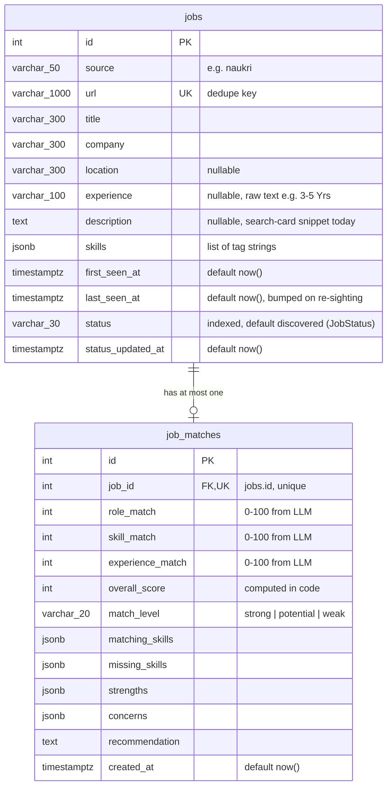
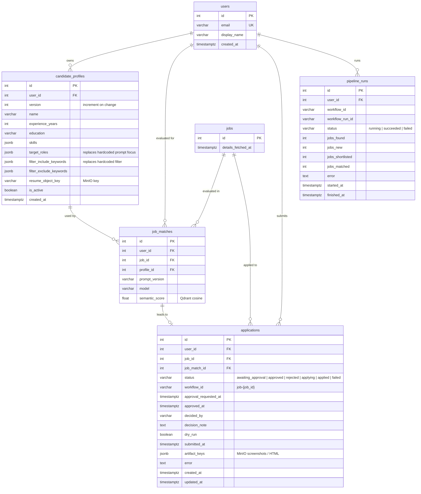

# 04 — Data model

PostgreSQL is the source of truth ([ADR-003](adr/ADR-003-postgresql-source-of-truth.md)). Qdrant
holds derived vectors keyed by `jobs.id` and can be rebuilt from Postgres
(`scripts/sync_jobs_to_qdrant.py`).

## Current tables (Built)

Defined in `app/db/models.py`, created by migrations `e38fb9a63e38` (jobs), `6fc31f68061a` (job_matches) and
`b5d33dd745b3` (`jobs.status`, `jobs.status_updated_at`).



Notes on current behaviour:

- `JobRepository.save_jobs` inserts new URLs and updates `last_seen_at` for known URLs, in one commit
  (`app/db/job_repository.py:19`). Jobs without a URL are skipped with a warning.
- "Unmatched" = no `job_matches` row and `last_seen_at` within 14 days (`get_unmatched_jobs_with_ids`).
  `main.py` still uses this query and ignores `jobs.status`, so jobs it filtered out or ranked below
  threshold are loaded again on every run ([known issue](12-roadmap-and-status.md#known-issues)).
- `jobs.status` is a plain `String(30)`, not a DB enum, so adding a value needs no migration. Allowed
  values live in one place: `JobStatus` (`app/models/job_status.py`): `discovered`, `filtered_out`,
  `shortlisted`, `matched`, `awaiting_approval`, `approved`, `rejected`, `expired`,
  `applied_dry_run`, `applied`, `needs_manual`, `failed` (`applied` / `needs_manual` were added
  without a migration). Only the Temporal workflows and their activities change it, through
  `JobRepository.update_status` (which also sets `status_updated_at`). The migration backfilled
  `matched` for jobs that already had a `job_matches` row.
- The daily apply cap is derived from `jobs.status` + `status_updated_at`
  (`JobRepository.count_status_since`, served by `ix_jobs_status`), and applies are serialized with a
  Postgres advisory transaction lock (`JobRepository.lock_applies`, key `APPLY_LOCK_KEY`). No
  `applications` table yet ([03](03-workflows.md#apply-safety-rails-built)).
- `JobRepository.save_match` is an upsert (`ON CONFLICT (job_id) DO UPDATE`): a retried activity or a
  re-run workflow overwrites the match, and the latest evaluation wins.
- `JobRepository.get_pending_approvals()` joins `jobs` (status `awaiting_approval`) with `job_matches`
  for `scripts/list_pending.py`.
- `job_matches.job_id` is `UNIQUE` → one evaluation per job, globally. Correct for one user; wrong
  once there are multiple users or profile versions.
- No `ON DELETE` behaviour on the FK; deleting a job with a match fails.
- The ORM declares `default=list` for JSONB columns (Python-side); the DB has no server default.

### Indexes (current)

| Table | Index | Source |
|---|---|---|
| `jobs` | PK `id` | migration |
| `jobs` | UNIQUE `url` | migration |
| `jobs` | `ix_jobs_status` on `status` | migration `b5d33dd745b3` |
| `job_matches` | PK `id` | migration |
| `job_matches` | UNIQUE `job_id` (also serves the join in `get_unmatched_jobs_with_ids`) | migration |

Missing: `jobs.last_seen_at` (filtered in the unmatched query). Fine at current volume (hundreds of rows).

## Planned tables



Only new / changed columns are shown for `jobs` and `job_matches`.

### Planned indexes and constraints

| Table | Index / constraint | Why |
|---|---|---|
| `jobs` | `(last_seen_at)` | Recency window. |
| `job_matches` | UNIQUE `(user_id, job_id, profile_id, prompt_version)` replaces UNIQUE `(job_id)` | Multi-user and re-evaluation after prompt/profile changes. |
| `applications` | UNIQUE `(user_id, job_id)` | Never two applications for the same job (mirrors workflow ID). |
| `applications` | CHECK `status NOT IN ('applying','applied') OR approved_at IS NOT NULL` | Enforce human approval at the DB level too. |
| `applications` | `(user_id, status)` | Dashboard queues. |
| `candidate_profiles` | partial UNIQUE `(user_id) WHERE is_active` | One active profile per user. |
| `pipeline_runs` | `(user_id, started_at DESC)` | Run history. |

Open question: in the multi-user phase, lifecycle state before `matched` is per user, so `jobs.status`
would move to a per-user table. Decide at Phase 6.

## Migration strategy (Alembic)

- `alembic/env.py` builds the URL from `app.config.settings` (`app/db/database.py`) — the
  `sqlalchemy.url` in `alembic.ini` is a placeholder and is overridden. Migrations run through the
  async engine.
- `target_metadata = Base.metadata`; `app.db.models` is imported so autogenerate sees all tables.

Workflow for every schema change:

```bash
# 1. Change app/db/models.py
# 2. Generate
uv run alembic revision --autogenerate -m "add jobs.status"
# 3. Review the generated file by hand (autogenerate misses renames, server defaults, CHECKs, enum changes)
# 4. Apply locally
uv run alembic upgrade head
# 5. Verify downgrade works
uv run alembic downgrade -1 && uv run alembic upgrade head
```

Rules:

- One logical change per revision; message in imperative form.
- Never edit a migration that has been merged to `main`; add a new one.
- Additive first: add nullable column → backfill in a separate step → add `NOT NULL`. Exception: a
  column with a constant `server_default` (like `jobs.status`) can be added `NOT NULL` in one step on
  Postgres, then backfilled with `op.execute` in the same revision.
- Data migrations use `op.execute` with SQL, not ORM models (models change over time).
- Replacing `UNIQUE(job_id)` on `job_matches` is a two-step migration: add `user_id` with a backfill
  to the single existing user, then swap constraints.
- CI (planned) runs `alembic upgrade head` on an empty database and fails on
  `alembic check` drift.
