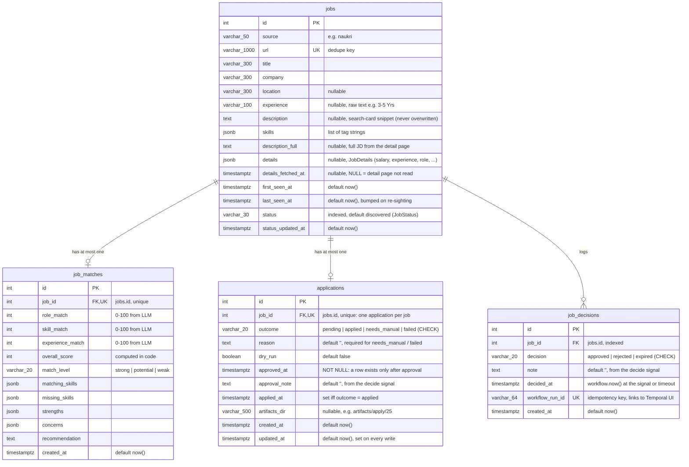
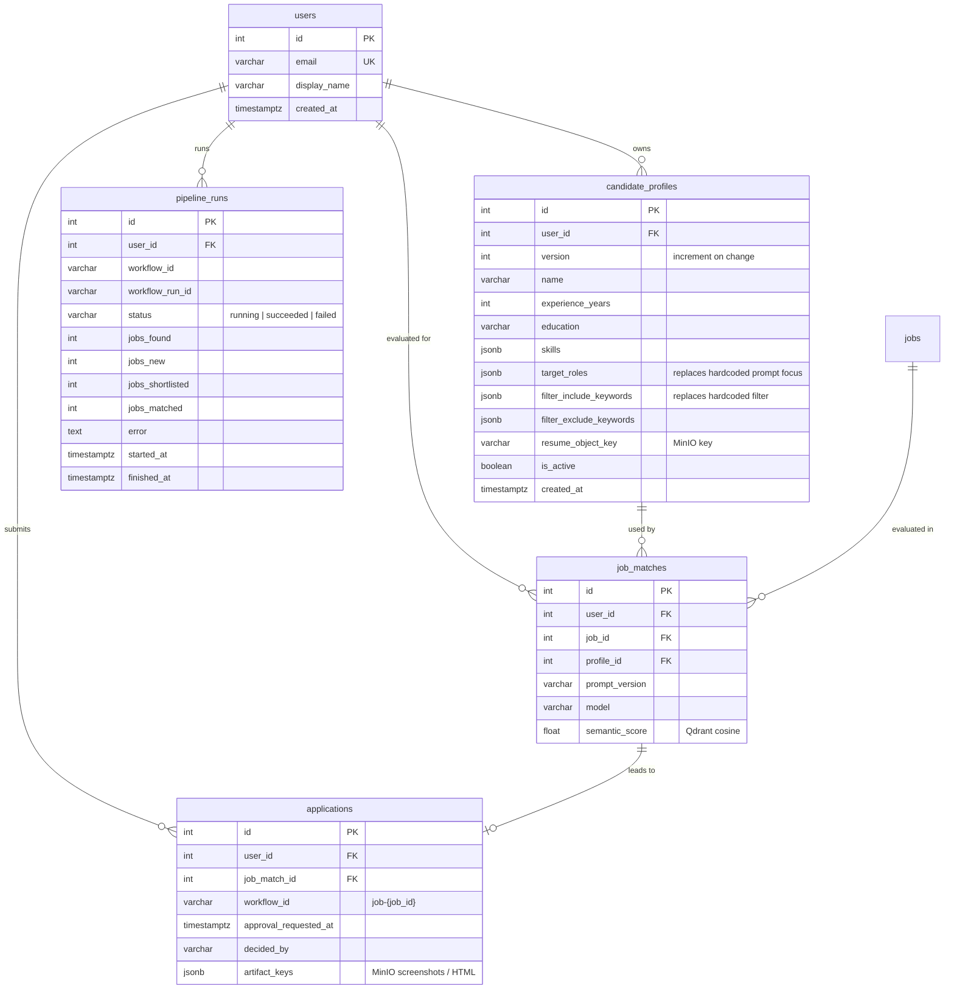

# 04 — Data model

PostgreSQL is the source of truth ([ADR-003](adr/ADR-003-postgresql-source-of-truth.md)). Qdrant
holds derived vectors keyed by `jobs.id` and can be rebuilt from Postgres
(`scripts/sync_jobs_to_qdrant.py`).

## Current tables (Built)

Defined in `app/db/models.py`, created by migrations `e38fb9a63e38` (jobs), `6fc31f68061a` (job_matches) and
`b5d33dd745b3` (`jobs.status`, `jobs.status_updated_at`), `f734e9e72583` (applications),
`7a754c37777b` (job_decisions) and `b50143f8cf9c` (`jobs.description_full`, `details`, `details_fetched_at`).



Notes on current behaviour:

- `JobRepository.save_jobs` inserts new URLs and updates `last_seen_at` for known URLs, in one commit
  (`app/db/job_repository.py:19`). Jobs without a URL are skipped with a warning.
- "Unmatched" = no `job_matches` row and `last_seen_at` within 14 days (`get_unmatched_jobs_with_ids`).
  `main.py` still uses this query and ignores `jobs.status`, so jobs it filtered out or ranked below
  threshold are loaded again on every run ([known issue](12-roadmap-and-status.md#known-issues)).
- `jobs.status` is a plain `String(30)`, not a DB enum, so adding a value needs no migration. Allowed
  values live in one place: `JobStatus` (`app/models/job_status.py`): `discovered`, `filtered_out`,
  `shortlisted`, `matched`, `awaiting_approval`, `approved`, `rejected`, `expired`,
  `applied_dry_run`, `applied`, `needs_manual`, `failed` (`applied` / `needs_manual` were added
  without a migration). Only the Temporal workflows and their activities change it, through
  `JobRepository.update_status` (which also sets `status_updated_at`).
  - **`applied` is terminal:** every `jobs.status` write (`_set_job_status`, used by `update_status`
    and the combined commits) has `WHERE NOT EXISTS (live applied applications row)` unless the new
    status is `applied`. A refused write returns False and logs `job_status_update_refused`. One
    guarded `UPDATE`, so no check-then-write race. Defense in depth behind the workflow's
    `is_applied_live` check ([03](03-workflows.md)). The migration backfilled
  `matched` for jobs that already had a `job_matches` row.
- `applications` (`ApplicationRecord`, values in `ApplicationOutcome`, `app/models/application.py`) is
  the source of truth for applying; `jobs.status` only mirrors it. The workflow rewrites `jobs.status`
  (e.g. `approved`) before every apply, so `jobs.status` cannot prove a job was never applied.
  - Written only through `JobRepository`: `record_approval` (row `pending` + `job_decisions` row +
    `jobs.status=approved`),
    `save_apply_result` (final outcome + `jobs.status`), `record_manual_apply`
    (`scripts/mark_applied.py`) and `insert_application_if_missing` (`scripts/backfill_applications.py`).
    Each writes `applications` and `jobs` in **one commit**: both change or neither does.
  - Every write has the guard `NOT (outcome = 'applied' AND NOT dry_run)`: a row applied live is never
    overwritten (re-approval, a second apply result or a manual mark returns False /
    raises `ApplicationNotWritableError`). A dry-run `applied` row does not block the real apply.
  - `applied_at` / `updated_at` use `clock_timestamp()`, not `now()`: `now()` is the transaction start,
    and an apply holds its transaction (and lock) open for the whole browser run.
  - Jobs 23 and 25 (applied before the table existed) were backfilled by
    `scripts/backfill_applications.py`, with times taken from artifacts and Temporal history. A script,
    not a migration, because those facts only exist in the local database.
- `job_decisions` (`JobDecisionRecord`, values in `Decision`, `app/models/decision.py`) is an
  append-only log of what happened at the approval step: `approved` (`record_approval`), `rejected` /
  `expired` (`record_decision`, same commit as `jobs.status`). Many rows per job are allowed (reject
  now, re-run and approve later). Kept apart from `applications` on purpose: a row there means
  "approved" and passes `ApplyService`'s approval check. `UNIQUE workflow_run_id` + `ON CONFLICT DO
  NOTHING` make activity retries log a decision once. No backfill: older rejections exist only in
  Temporal history. Read with `JobRepository.get_decisions(job_id)`.
- The daily apply cap counts `applications` rows with `outcome='applied'`, the same `dry_run` and
  `applied_at` since IST midnight (`JobRepository.count_applied_since`). Applies are serialized with a
  Postgres advisory transaction lock (`JobRepository.lock_applies`, key `APPLY_LOCK_KEY`)
  ([03](03-workflows.md#apply-safety-rails-built)).
- Job detail page data (`b50143f8cf9c`): three nullable columns on `jobs`, so the migration needs no
  backfill. `description_full` is kept apart from `description` (the card snippet) so we always know
  which text we have. `details` is `JobDetails` (`app/models/job_details.py`) as JSONB — not queried
  yet; a field gets a typed column once something filters on it. `JobRepository.save_details`
  overwrites all three in one commit (idempotent). `_to_job` returns `description_full or
  description`, fills `Job.details` and `Job.salary`, so filter, embeddings and the LLM all get the
  best text without knowing its source.
- `JobRepository.save_match` is an upsert (`ON CONFLICT (job_id) DO UPDATE`): a retried activity or a
  re-run workflow overwrites the match, and the latest evaluation wins.
- `JobRepository.get_pending_approvals()` joins `jobs` (status `awaiting_approval`) with `job_matches`
  for `scripts/list_pending.py`; `get_jobs_needing_attention()` outer-joins `jobs` (status
  `needs_manual` / `failed`) with `applications` for the reason (none if the workflow failed before
  approval).
- `job_matches.job_id` is `UNIQUE` → one evaluation per job, globally. Correct for one user; wrong
  once there are multiple users or profile versions.
- No `ON DELETE` behaviour on the FKs; deleting a job with a match, an application or a decision fails (wanted for
  the audit trail).
- The ORM declares `default=list` for JSONB columns (Python-side); the DB has no server default.

### Indexes (current)

| Table | Index | Source |
|---|---|---|
| `jobs` | PK `id` | migration |
| `jobs` | UNIQUE `url` | migration |
| `jobs` | `ix_jobs_status` on `status` | migration `b5d33dd745b3` |
| `job_matches` | PK `id` | migration |
| `job_matches` | UNIQUE `job_id` (also serves the join in `get_unmatched_jobs_with_ids`) | migration |
| `applications` | PK `id`, UNIQUE `job_id` (`applications_job_id_key`) | migration `f734e9e72583` |
| `job_decisions` | PK `id`, `ix_job_decisions_job_id`, UNIQUE `workflow_run_id` (`job_decisions_workflow_run_id_key`) | migration `7a754c37777b` |

### Constraints on `applications` (current)

| Constraint | Rule | Why |
|---|---|---|
| `ck_applications_outcome` | `outcome IN ('pending','applied','needs_manual','failed')` | No typo values in the audit table (unlike the flexible `jobs.status`); a new value needs a migration. |
| `ck_applications_applied_at` | `(outcome = 'applied') = (applied_at IS NOT NULL)` | `applied_at` exactly when applied. |
| `ck_applications_reason` | `outcome NOT IN ('needs_manual','failed') OR reason <> ''` | A human must see what to do next. |
| `ck_applications_applied_after_approval` | `applied_at >= approved_at` | Never applied before approval (passes while `applied_at` is NULL). |
| NOT NULL `approved_at` | | A row exists only after a human approval. |

`job_decisions` has `ck_job_decisions_decision`: `decision IN ('approved','rejected','expired')`.

Missing: `jobs.last_seen_at` (filtered in the unmatched query). Fine at current volume (hundreds of rows).

## Planned tables



Only new / changed columns are shown for `jobs`, `job_matches` and `applications`.

### Planned indexes and constraints

| Table | Index / constraint | Why |
|---|---|---|
| `jobs` | `(last_seen_at)` | Recency window. |
| `job_matches` | UNIQUE `(user_id, job_id, profile_id, prompt_version)` replaces UNIQUE `(job_id)` | Multi-user and re-evaluation after prompt/profile changes. |
| `applications` | UNIQUE `(user_id, job_id)` replaces UNIQUE `(job_id)` | Multi-user. |
| `applications` | `(user_id, outcome)` | Dashboard queues. |
| `candidate_profiles` | partial UNIQUE `(user_id) WHERE is_active` | One active profile per user. |
| `pipeline_runs` | `(user_id, started_at DESC)` | Run history. |

Open question: in the multi-user phase, lifecycle state before `matched` is per user, so `jobs.status`
would move to a per-user table. Decide at Phase 6.

## Migration strategy (Alembic)

- `alembic/env.py` builds the URL from `app.config.settings` (`app/db/database.py`) — the
  `sqlalchemy.url` in `alembic.ini` is a placeholder and is overridden. Migrations run through the
  async engine.
- `target_metadata = Base.metadata`; `app.db.models` is imported so autogenerate sees all tables.

Workflow for every schema change:

```bash
# 1. Change app/db/models.py
# 2. Generate
uv run alembic revision --autogenerate -m "add jobs.status"
# 3. Review the generated file by hand (autogenerate misses renames, server defaults, CHECKs, enum changes)
# 4. Apply locally
uv run alembic upgrade head
# 5. Verify downgrade works
uv run alembic downgrade -1 && uv run alembic upgrade head
```

Rules:

- One logical change per revision; message in imperative form.
- Never edit a migration that has been merged to `main`; add a new one.
- Additive first: add nullable column → backfill in a separate step → add `NOT NULL`. Exception: a
  column with a constant `server_default` (like `jobs.status`) can be added `NOT NULL` in one step on
  Postgres, then backfilled with `op.execute` in the same revision.
- Data migrations use `op.execute` with SQL, not ORM models (models change over time).
- Replacing `UNIQUE(job_id)` on `job_matches` is a two-step migration: add `user_id` with a backfill
  to the single existing user, then swap constraints.
- CI (planned) runs `alembic upgrade head` on an empty database and fails on
  `alembic check` drift.
