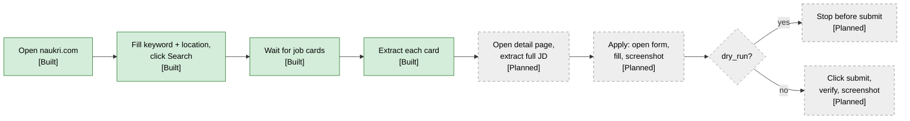

# 06 — Browser automation

Naukri has no public job-seeker API, so the system drives the website with the **Python Playwright
library** (async API, Chromium) running locally ([ADR-002](adr/ADR-002-playwright-for-naukri.md)).
Chromium is **headed by default** (`BROWSER_HEADLESS=false`) so the user can see what happens.

## Flow

### Current implementation (Built)

| Step | Code | Behaviour |
|---|---|---|
| Launch | `NaukriBrowser.start()` (`app/browser/naukri_browser.py`) | New Playwright, `chromium.launch(headless=...)`, new context every run, default timeout `BROWSER_TIMEOUT_MS` (20 s). With `logged_in=True` the context starts from the saved, decrypted session (see below). |
| Open | `open_naukri()` | `goto("https://www.naukri.com/")`. |
| Search | `search_jobs()` | Fill keyword + location inputs, click text "Search", `wait_for_selector(JOB_CARD)`. |
| Extract | `NaukriJobSource.get_jobs()` (`app/job_sources/naukri.py:30`) → `NaukriExtractor.extract_job()` | Iterates cards on the **first result page only**; per-card failures are logged (`job_extraction_failed`) and skipped. |
| No results | `naukri.py:53` | Timeout waiting for cards → `no_job_cards_found` warning, returns `[]`. |
| Close | `finally: browser.close()` | Always closes browser and Playwright. |

Search does not log in (results are public). Only the inspection tools below use a logged-in session.

## Selectors

Selectors live as constants / literals; they will break when Naukri changes its markup.

| Purpose | Selector | File |
|---|---|---|
| Keyword input | `input[placeholder="Enter skills / designations / companies"]` | `app/browser/naukri_browser.py:7` |
| Location input | `input[placeholder="Enter location"]` | `app/browser/naukri_browser.py:8` |
| Search button | `get_by_text("Search", exact=True)` | `app/browser/naukri_browser.py:40` |
| Job card | `.srp-jobtuple-wrapper` | `app/browser/naukri_browser.py:9` |
| Title / URL | `.title`, `a.title[href]` | `app/job_sources/naukri_extractor.py` |
| Company | `.comp-name` | same |
| Location | `.loc` | same |
| Experience (optional) | `.exp` | same |
| Description snippet | `.job-desc` | same |
| Skill tags | `.tags-gt .tag-li` | same |
| Detail-page description | **unknown** — `scripts/inspect_job_page.py` saves a detail page's HTML to `/tmp/naukri_job_page.html` to find it | — |

Planned hardening: move all selectors into one `app/browser/naukri_selectors.py`, prefer
role/text-based locators where possible, and add a smoke test against a saved HTML fixture so a
markup change fails in CI rather than silently returning empty fields.

## Session reuse via `storage_state` (Built)

Applying requires a logged-in Naukri account ([ADR-014](adr/ADR-014-encrypted-naukri-session.md)).

1. `scripts/naukri_login.py` first checks `NAUKRI_STATE_KEY` (`check_key()`), so a manual login is
   never wasted, then always opens a **headed** browser at `NAUKRI_LOGIN_URL`
   (`/nlogin/login`). The user logs in manually (including any OTP) and presses Enter in the
   terminal. The system never sees or stores the Naukri password.
2. `NaukriBrowser.is_logged_in()` waits up to 5 s for `LOGGED_IN_MARKER` (header avatar / profile
   link). Only if it is visible is `context.storage_state()` saved; otherwise nothing is written and
   the script exits 1.
3. `app/browser/session_store.py`: `save_state` / `load_state` encrypt with **Fernet** using
   `NAUKRI_STATE_KEY` into `NAUKRI_STATE_PATH` (default `secrets/naukri_state.enc`; folder `0700`,
   file `0600`). Missing key, missing file or wrong key raise `SessionStateError` with a message that
   contains no secret. Logs show only cookie count, domains and origin count.
4. `NaukriBrowser(logged_in=True)` creates the context with `new_context(storage_state=load_state())`.
5. Expiry: callers check `is_logged_in()`; if false, re-run `scripts/naukri_login.py`.
   *Planned:* a non-retryable `SessionExpired` activity error once apply runs inside Temporal.

`LOGGED_IN_MARKER` detected a real login on the first live run (2026-09-24).

## Apply-flow inspection (Built, no apply)

`scripts/inspect_apply_flow.py <job_id> [--click]` — a manual tool to learn the apply markup before
any apply code exists.

- Loads the job URL from Postgres, opens it with the saved session, stops if the session expired.
- Saves `artifacts/inspect/<job_id>/01_job_page.html` + full-page `.png`.
- Reads the texts of `APPLY_BUTTON_CANDIDATES` and classifies them with
  `classify_apply_button()` (`app/browser/apply_button.py`): `naukri_apply`, `company_site`,
  `already_applied` or `unknown`. Prints the texts it saw, so wrong selectors are easy to spot.
- `--click` acts **only** when the type is `naukri_apply`: clicks the button whose text is exactly
  "Apply" / "Apply now" once, waits 5 s, saves `02_after_click.*`, then closes the browser. It
  never answers questions and never presses a submit button.
- The button selectors are **unverified**; the saved HTML is used to correct them.

## Rate limiting and delays

| Rule | Status |
|---|---|
| One browser session against Naukri at a time (worker concurrency for browser activities = 1) | Planned |
| Random delay between detail pages: `DETAIL_PAGE_DELAY_SECONDS` (3.0) ± jitter | **In progress** — setting exists in `app/config.py:32`, not used anywhere |
| Max detail pages per run (e.g. 30) and max applications per day (e.g. 10) | Planned |
| Back off for hours on HTTP 429 / challenge pages; no retries against a CAPTCHA | Planned |
| Headed by default, real Chromium, no stealth plugins | Built (headed default); no-stealth is a rule |

## Screenshots and artifacts (Planned)

Today only the inspection script writes artifacts, to the local, gitignored `artifacts/` folder.

- Capture full-page screenshot + page HTML on: every apply step (before fill, before submit, after
  submit) and on any browser activity failure.
- Store in MinIO under `artifacts/{job_id}/{workflow_run_id}/{step}.png`
  ([ADR-013](adr/ADR-013-minio-artifacts.md)); keys recorded in `applications.artifact_keys`.
- Screenshots may contain PII (the candidate's filled form) — same retention rules as the resume.

## Failure handling

| Failure | Current | Planned |
|---|---|---|
| Search cards never appear | Warning, return `[]` | Same, plus screenshot; distinguish "no results" from "blocked". |
| One card fails to parse | Warning, skip card | Same, plus counter in `pipeline_runs`. |
| Browser crash / navigation timeout | Exception propagates, `main.py` aborts | Temporal activity retry (3×, backoff) with heartbeats. |
| Session expired | n/a | Non-retryable `SessionExpired`, notify user. |
| CAPTCHA / bot challenge | n/a | Non-retryable `Blocked`, pause schedule, notify user. |
| Submit outcome unknown (timeout after click) | n/a | Mark `failed` with `outcome_unknown`; **never auto-retry submit**; user checks Naukri manually. |

## Dry-run mode (Planned)

- `APPLY_DRY_RUN=true` is the default.
- Dry-run executes the full apply flow up to the final submit click, captures screenshots, and
  records the application with `dry_run = true`.
- Switching to live applying is a deliberate config change, logged at startup with a warning.

## Headless mode

`BROWSER_HEADLESS=true` in `.env` runs Chromium headless (e.g. on a server). Headless is more likely
to be detected as automation; use it for discovery at most, and keep applying headed.
