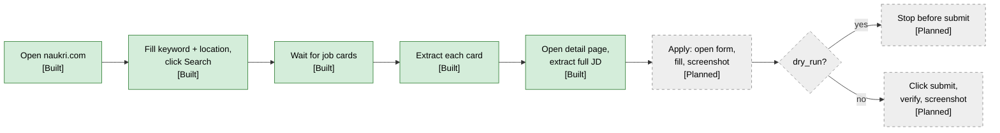
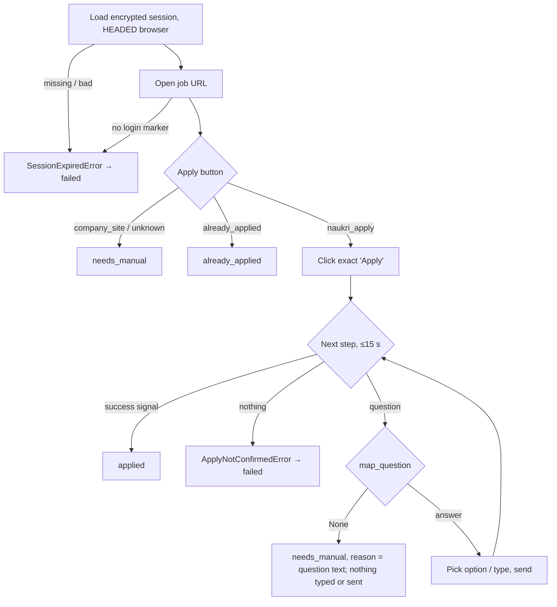

# 06 — Browser automation

Naukri has no public job-seeker API, so the system drives the website with the **Python Playwright
library** (async API, Chromium) running locally ([ADR-002](adr/ADR-002-playwright-for-naukri.md)).
Chromium is **headed by default** (`BROWSER_HEADLESS=false`) so the user can see what happens.

## Flow

### Current implementation (Built)

| Step | Code | Behaviour |
|---|---|---|
| Launch | `NaukriBrowser.start()` (`app/browser/naukri_browser.py`) | New Playwright, `chromium.launch(headless=...)`, new context every run, default timeout `BROWSER_TIMEOUT_MS` (20 s). With `logged_in=True` the context starts from the saved, decrypted session (see below). |
| Open | `open_naukri()` | `goto("https://www.naukri.com/")`. |
| Search | `search_jobs()` | Fill keyword + location inputs, click text "Search", `wait_for_selector(JOB_CARD)`. |
| Extract | `NaukriJobSource.get_jobs()` (`app/job_sources/naukri.py`) → `_extract_page()` → `NaukriExtractor.extract_job()` | Iterates the cards of each result page; per-card failures are logged (`job_extraction_failed`) and skipped. A card without a `.job-desc` snippet is kept with an empty description (the detail page fills it later) instead of waiting a full timeout. |
| Paginate | `NaukriBrowser.next_page_url()` + `open_results_page(url)` | Up to `max_pages` pages (the `discover_jobs` activity passes `MAX_SEARCH_PAGES`, default 3, max 5; the class default is 1). Follows the "Next" link's `href` (plain `goto`, no click), because page 2+ URLs (`/<search>-2`) drop the `k=` / `l=` query. Sleeps `SEARCH_PAGE_DELAY_SECONDS` + `uniform(0, SEARCH_PAGE_JITTER_SECONDS)` between pages. Jobs are de-duplicated by URL. Stops early when a page has **no new cards**, there is **no Next link** (missing, no `href` or `disabled`), or a later page **times out** (keeps the jobs read so far, `search_page_timeout`). Live 2026-10-16: 3 pages, 59 unique jobs, 45 s. |
| No results | `naukri.py` | Timeout waiting for cards on page 1 → `no_job_cards_found` warning, returns `[]`. |
| Close | `finally: browser.close()` | Always closes browser and Playwright. |

Search does not log in (results are public). Only the inspection tools below use a logged-in session.

## Selectors

Selectors live as constants / literals; they will break when Naukri changes its markup.

| Purpose | Selector | File |
|---|---|---|
| Keyword input | `input[placeholder="Enter skills / designations / companies"]` | `app/browser/naukri_browser.py:7` |
| Location input | `input[placeholder="Enter location"]` | `app/browser/naukri_browser.py:8` |
| Search button | `get_by_text("Search", exact=True)` | `app/browser/naukri_browser.py:40` |
| Job card | `.srp-jobtuple-wrapper` | `app/browser/naukri_browser.py:9` |
| Title / URL | `.title`, `a.title[href]` | `app/job_sources/naukri_extractor.py` |
| Company | `.comp-name` | same |
| Location | `.loc` | same |
| Experience (optional) | `.exp` | same |
| Description snippet (optional) | `.job-desc` | same |
| Next results page | `SEARCH_NEXT_PAGE` = `a:has(> span:text-is('Next'))` (verified on `tests/fixtures/naukri/search_page_1.html` / `_2.html`, saved by `scripts/inspect_search_page.py`; checked in Chromium by `tests/browser/test_search_pagination.py`) | `app/browser/naukri_selectors.py` |
| Skill tags | `.tags-gt .tag-li` | same |
| Detail-page JD + details | See [Job detail page](#job-detail-page-built) | `app/browser/naukri_selectors.py` |

## Job detail page (Built)

The search card only has a ~90-char snippet. `fetch_job_details` (activity, see
[03](03-workflows.md)) reads each job's detail page **after the keyword filter** — read only, no
clicks, **logged out** (public page; keeps this traffic away from the apply account).

| Step | Code | Behaviour |
|---|---|---|
| Fetch | `fetch_job_page()` (`app/job_sources/naukri_detail.py`) | New browser, `goto(url, wait_until="domcontentloaded")`, wait for `JOB_DETAIL_READY` (missing → logged, HTML still parsed), return `page.content()`. HTTP ≥ 400 → `DetailPageUnavailable` (retryable). |
| Parse | `parse_job_detail(html)` (`app/job_sources/naukri_detail_parser.py`) | Pure function, stdlib only. 1) schema.org `JobPosting` JSON-LD → JD + `JobDetails` (skills, salary, experience months, employment type, industry, department, role, education, date posted / valid through). 2) Fallback: text of the element whose class starts with `styles_JDC__dang-inner-html__` (JD only, `source="dom"`). 3) Else `DetailParseError`. A JD under 50 chars counts as missing, so an empty JD is never saved. |

| Selector | Value | Status |
|---|---|---|
| `JOB_POSTING_JSON_LD` + `JOB_POSTING_TYPE` | `script[type='application/ld+json']`, `@type == "JobPosting"` | Verified 2026-10-07 (`tests/fixtures/naukri/job_detail_{34,37,39}.html`) |
| `JOB_DESCRIPTION_CLASS_PREFIX` | `styles_JDC__dang-inner-html__` (CSS-module hash after it changes on deploys) | Verified 2026-10-07 (same fixtures) |

**Headless is blocked:** Naukri answers HTTP 403 "Access Denied" to headless Chromium (seen
2026-10-07); headed (`BROWSER_HEADLESS=false`, needs a display) gets 200.

**TLS inspection:** on a network whose firewall re-signs HTTPS (seen 2026-10-08: Sophos CA issuing
`*.naukri.com`), Chromium fails with `ERR_CERT_AUTHORITY_INVALID`. The code does not disable TLS
checks; the job then continues with the snippet. Fix on the network/OS side (done for the dev
network on 2026-10-08: issuer is GlobalSign again, see [known issue 17](12-roadmap-and-status.md#known-issues)).

Fixtures: `uv run python -m scripts.inspect_job_page <job_id>...` opens the pages (headed, delay
between pages) and writes trimmed fixtures (JSON-LD + JD section, ~9 KB instead of ~260 KB) to
`tests/fixtures/naukri/job_detail_<id>.html`, printing what the parser found.

### Apply-flow selectors (Built)

All apply-flow selectors (and the login marker) live in `app/browser/naukri_selectors.py`, each
marked **VERIFIED <date>** (seen in a saved live page) or **NOT VERIFIED**.

| Purpose | Selector | Status |
|---|---|---|
| Logged-in marker | `.nI-gNb-drawer__icon, .nI-gNb-icon-img, a[href*='/mnjuser/profile']` | Verified 2026-09-24 |
| Company-site button | `#company-site-button` | Verified 2026-09-24 (`tests/fixtures/naukri/company_site.html`) |
| Naukri apply button | `#apply-button` | Verified 2026-10-07 (`naukri_apply.html`) |
| Already applied | `#already-applied` (a ``; + exact-text "Applied" fallback) | Verified 2026-10-15 (`tests/fixtures/naukri/already_applied.html`) |
| Chatbot drawer | `.chatbot_DrawerContentWrapper` | Verified 2026-10-15 (`tests/fixtures/naukri/chatbot.html`, job 1076) |
| Chatbot bot message (last = open question) | `… .botMsg` | Verified 2026-10-15 (greeting + question) |
| Chatbot text input | `… [contenteditable='true']` (footer `div.textArea`) | Verified 2026-10-15 (present, hidden during a checkbox question; typing not checked live) |
| Chatbot checkboxes + their labels | `… input[type='checkbox']`, `… label.mcc__label` | Verified 2026-10-15 (5 cities) |
| Chatbot send | `… .sendMsg` ("Save"; its parent `div.send` is `disabled` until an answer) | Verified 2026-10-15 |
| Chatbot radio labels | `… .ssrc__radio-btn-container label` (`label.ssrc__label`, `for=` its radio) | Verified 2026-10-15 (`tests/fixtures/naukri/chatbot_radio.html`, job 7) |
| Apply confirmation | `.acp-header-container .job-title-text:has-text('Applied to')` (Naukri redirects to an apply-confirmation page) | Verified 2026-10-07 (`apply_success.html`) |
| Apply confirmation (fallback) | header button turns "Applied" | Not verified |

A wrong unverified selector can only make the applier stop (`needs_manual`, or an error →
`failed`), never report a false `applied`. Verify them with `scripts/inspect_apply_flow.py` and add
sanitized samples to `tests/fixtures/naukri/`.

Planned hardening: move the search/card selectors above into `naukri_selectors.py` too.

## Session reuse via `storage_state` (Built)

Applying requires a logged-in Naukri account ([ADR-014](adr/ADR-014-encrypted-naukri-session.md)).

1. `scripts/naukri_login.py` first checks `NAUKRI_STATE_KEY` (`check_key()`), so a manual login is
   never wasted, then always opens a **headed** browser at `NAUKRI_LOGIN_URL`
   (`/nlogin/login`). The user logs in manually (including any OTP) and presses Enter in the
   terminal. The system never sees or stores the Naukri password.
2. `NaukriBrowser.is_logged_in()` waits up to 5 s for `LOGGED_IN_MARKER` (header avatar / profile
   link). Only if it is visible is `context.storage_state()` saved; otherwise nothing is written and
   the script exits 1.
3. `app/browser/session_store.py`: `save_state` / `load_state` encrypt with **Fernet** using
   `NAUKRI_STATE_KEY` into `NAUKRI_STATE_PATH` (default `secrets/naukri_state.enc`; folder `0700`,
   file `0600`). Missing key, missing file or wrong key raise `SessionStateError` with a message that
   contains no secret. Logs show only cookie count, domains and origin count.
4. `NaukriBrowser(logged_in=True)` creates the context with `new_context(storage_state=load_state())`.
5. Expiry: callers check `is_logged_in()`; if false, re-run `scripts/naukri_login.py`.
   *Planned:* a non-retryable `SessionExpired` activity error once apply runs inside Temporal.

`LOGGED_IN_MARKER` detected a real login on the first live run (2026-09-24).

## Apply-flow inspection (Built, no apply)

`scripts/inspect_apply_flow.py <job_id> [--click]` — a manual tool to learn / re-check the apply
markup. Without `--click` nothing is clicked.

- Loads the job URL from Postgres, opens it with the saved session, stops if the session expired.
- Saves `artifacts/inspect/<job_id>/01_job_page.html` + full-page `.png`.
- Reads `(id, text)` of every `APPLY_BUTTONS` match (`read_apply_buttons()`) and classifies them with
  `classify_apply_button()` (`app/browser/apply_button.py`): a known element id wins, else the exact
  text → `naukri_apply`, `company_site`, `already_applied` or `unknown`. Prints what it saw.
- `--click` acts **only** when the type is `naukri_apply` and after a `y/N` prompt: clicks the
  button whose text is exactly "Apply" / "Apply now" once, waits 5 s, saves `02_after_click.*`,
  then closes the browser. It never answers questions or clicks anything else.
- **Warning:** for a job without screening questions, that one click **is a real application**
  (seen live on 2026-10-07, job 23: Naukri went straight to the "Applied to …" page).
- Verified so far: `company_site`, `naukri_apply`, the apply confirmation, already-applied, and
  and all chatbot selectors ([Selectors](#apply-flow-selectors-built)). Live 2026-10-15: job 1070
  had no questions (the click applied); job 1076 opened the chatbot with a multi-select "Which of
  these locations are you willing to relocate to?" (5 city checkboxes); job 7 asked "What is your
  current location" with two radios ("Noida / Delhi / Gurgaon", "None of above"), with no
  greeting before it.

## Company-site inspection (Built, nothing typed)

`scripts/inspect_company_site.py` looks at the career site behind an "Apply on company site" job,
to collect fixtures before any form filler exists. It types, uploads and submits nothing.

- `<job_id> [<job_id> ...]`: opens each job with the saved session, one at a time and
  `DETAIL_PAGE_DELAY_SECONDS` apart, and ends with a one-line summary per job. A page error
  (timeout, TLS) skips that job; an expired session stops the run. **Without `--click` nothing is
  clicked**, so a batch safely finds the company-site jobs. An expired job shows `unknown`, because
  Naukri redirects it to a search page.
- `--click`: only for a `company_site` button, and after a `y/N` prompt per job, it clicks
  `#company-site-button` once (`follow_company_site_button()` in `app/browser/company_site_page.py`).
  The button is a `<button>` with no `href`, so the click is the only way to get the URL. A new tab
  is expected; if none opens within 10 s, the same tab is treated as redirected. Then waits 5 s.
  **Warning:** Naukri then shows the job as **Applied** (`#already-applied`), although nothing was
  submitted on the company site (seen live 2026-10-15, job 455). See known issue #18. To look at a
  company page without this side effect, use `--url`.
- **Hidden form:** if the report has the "form is hidden" stop, `find_job_opener(html, title)`
  (pure, in `company_portal.py`) looks for exactly one `<a>` / `<button>` whose `onclick` has the
  job title as an exact quoted argument (case-insensitive, no fuzzy match). An `<a>` must also stay
  on the page (`href` empty, `#…` or `javascript:`). The inspector clicks it once
  (`open_job_form()`), waits 2 s and saves everything again as `03_*`, plus `03_form.png`
  (`screenshot_form()`): a screenshot of the visible `<form>` that has a file input, and nothing
  else. A full-page screenshot cuts off a form inside a scrollable modal (kmgus.com: only the
  modal's job description showed). With `--url`, the title
  comes from `--title`.
- **Job's own apply page:** if the page has no application form at all,
  `find_job_page_link(html, url, title)` (pure) looks for a heading that is exactly the job title
  (h1–h6, once on the page) and the first link after it whose text has "apply", before the next
  heading of the same or a higher level. The link must be http(s), on the same host and not an
  anchor on this page. The inspector then loads it (`open_company_page()`, an ordinary page load,
  nothing sent) and saves `03_*` (zaax.com: every "Apply Now" goes to one shared `/submit-resume/`
  form; `generic_zaax_job_openings.html`).
- `open_company_page()` is the one loader for a company URL (worker `open_company_url`, the job's
  apply page, `--url`, `apply_company_site`): if "load" does not fire within
  `BROWSER_TIMEOUT_MS` (slow third-party scripts; zaax.com's HTML alone took 7 s), it logs
  `company_page_load_timeout`, waits 5 s and reads what has rendered.
- `--url <url> [--title "<job title>"]`: opens a company page directly, without Naukri or a login.
- `--html <file> --url <url>`: re-runs detection on a saved page, no browser.
- Saves `artifacts/inspect/company/<job_id>/`: `01_job_page.*`, `02_company_site.html/.png`,
  `02_frame_<n>.html` for each iframe (embedded ATS forms live there) and `02_report.json`.
- Before saving, `read_documents()` marks every input / textarea / select the browser does not show
  (display or visibility hidden, opacity 0, zero size, off-screen, inside `aria-hidden`) with
  `data-jobagent-hidden`. This is only an attribute in the local DOM, nothing is sent to the site.
  The pure parser has no CSS, so this marker is how it learns that a field is hidden (honeypots,
  closed modals).
- Prints, per page and iframe: portal type, hard stops and fields (required mark, `h` for hidden,
  kind, label, name, autocomplete, options), plus the document with the most fields.

Detection is pure (`app/browser/company_portal.py`, `inspect_page(url, html)`), with stdlib
`HTMLParser`, like the detail-page parser. Tests run it on `tests/fixtures/company_sites/` (synthetic
pages for now, until live ones are saved).

- **Portal type:** URL domain first (`PORTAL_DOMAINS`: Workday, Greenhouse, Lever, SmartRecruiters,
  iCIMS, plus detect-only Darwinbox, Keka, Zoho Recruit), then embed markers in the HTML
  (Greenhouse iframe), then `generic_form`. A page is `generic_form` only when one `<form>` has an
  email field **and** a file input, so a job-alert box is never one. Anything else is `unknown`.
- **Fields:** inputs, textareas and selects (no hidden or button inputs). The label comes from a
  wrapping `<label>`, `label[for]`, `aria-label`, placeholder, `<legend>`, then name. A field is
  required when it has `required` / `aria-required="true"` or its label has `*` or Lever's `✱`.
  Radio buttons with the same name are merged into one field with options. CAPTCHA response fields
  (`g-recaptcha-response`, ...) are skipped. `visible` is False for a field marked hidden.
- **Hard stops** (the future filler will return `needs_manual` with this reason):
    - login: Workday, a password field, or page text such as "create account";
    - OTP or email verification: an OTP field, or page text such as "enter otp";
    - sensitive fields (Aadhaar, PAN, bank, IFSC, passport, card, payment). Only field labels
      and names are checked, so a JD saying "PAN India" stops nothing;
    - a **visible** CAPTCHA. An invisible one (`data-size="invisible"`, which Lever and
      Greenhouse use on submit) is ignored, because we never submit;
    - a Next/Continue button with no Submit button: a wizard we don't know;
    - an application form whose email field is hidden: it opens from a button or a modal.

## Company-site apply (Built: worker check + my fill session)

**Worker** (`apply_job`, live mode, approved job, `company_site` button). `NaukriJobApplier._check_company_site`:

1. Calls `on_company_site_click` (records `jobs.company_site_opened_at`), pauses, then clicks
   "Apply on company site" (`ApplyPage.open_company_site`; snapshots now show the company page).
2. Reads the page and its iframes. If the form is hidden, it opens it with `find_job_opener`, using
   the job's title from the DB (exact match only). If there is no form at all, it loads this
   job's own apply page with `find_job_page_link` (`ApplyPage.open_company_job_page`, snapshot
   `company_job_page`). That page's URL then becomes `external_url`.
3. Decides with `company_site_result()` (`app/browser/company_site_check.py`, pure):
    - no visible application form in the page or any iframe → `needs_manual` with the URL;
    - a form, but a blocking stop (login, sensitive field, unknown wizard) → `needs_manual`;
    - a form, plus at most a CAPTCHA / OTP (`split_stops`) → `ready_for_you`. `external_url` is the
      **page** URL even when the form is in an ATS iframe, because embed URLs carry expiring tokens
      (Greenhouse `validityToken`). The row also gets `portal` and `human_steps`.

It never types into the company site. If the job was clicked before (`company_site_url` known), the
applier skips Naukri and runs steps 2–3 on that URL (`ApplyPage.open_company_url`).

Live, 2026-10-15, job 3 (Tower Research): the page embeds Greenhouse's React job board in an
iframe. Its Yes/No questions and Country are searchable dropdowns: `combobox` kind (`role=combobox`
or `aria-autocomplete=list`), never filled, and left for me. Its PEP declaration mentions
"World Bank", so plain "bank" is no longer a sensitive word (now "bank account / name / details /
branch"). A "provide their name" referrer question got my own name in an offline check, so the
full-name rule now skips any label with a "?" and names of other people (referrer, employee, ...).
Result: `ready_for_you`.

**Me** (`scripts/apply_company_site.py <job_id>`, `ready_for_you` only):

1. Opens a **visible** browser on `external_url` (logged out, no Naukri click), and opens the hidden
   form the same way as the worker.
2. Runs the shared fill (`scripts/company_form_cli.fill_company_form`, the same code as
   `--fill-preview`). It finds the form in the page or in its iframe, and fills that `Frame`: fixed rules, learned answers, AI suggestions I approve, a `y/N`, fill + read
   back. CAPTCHA / OTP do not block it.
3. Saves `artifacts/apply/<job_id>/company-<time>/01_filled_form.png` (+ page, report).
4. Waits: I tick consents, solve CAPTCHA / OTP and click **Submit myself**. The script never
   clicks it. Meanwhile `watch_form()` keeps the form's values on every change, submit or button
   click, because Submit may leave the page. After Enter it saves `02_after_me.png`.
5. Asks "Did you submit?". `y` runs `record_manual_apply` (`applied`); `n` leaves `ready_for_you`.
6. Offers each answer I typed or changed in the browser as a learned answer, `y/N` each (see
   [learning from the browser](#learning-from-the-browser)), whether I submitted or not.

### Fill preview (Built, never submits)

`--fill-preview` lets a human check what the filler would type before any real filler exists.
It needs a `contact:` block in `answers.yaml` (`ContactAnswers`: first/last name, email, phone,
`resume_path`, optional `linkedin_url`). Unknown keys are rejected, and email, phone (10 or more
digits) and resume suffix (`.pdf` / `.doc` / `.docx`) are checked when the file loads.

1. `application_form(fields)` picks the first application form whose email field is visible. On
   a page with a hard stop, or without such a form, nothing is filled. Forms inside an iframe are
   not supported yet.
2. `map_form()` (`app/browser/company_form_mapper.py`, pure, no LLM) gives each field a value or
   a reason:
    - hidden fields: never filled;
    - checkboxes (consents): never ticked;
    - contact rules (email, phone, first, last or full name, LinkedIn, resume file) match on
      kind, `autocomplete`, label, name and id. Exactly one rule must match; two (e.g. "Email or
      phone") means no answer. "Name" is the full name unless the label says it is another name
      (company, father, college, ...). "Phone" is my mobile unless the field asks for another
      number (landline, fax, alternate, emergency, office, reference; zaax.com has a "Landline
      Number" `tel` field);
    - anything else goes to `apply_questions.map_question` (notice period, CTC, experience,
      location, relocation), the same rules as on Naukri.
3. Fields no rule or learned answer knows get up to 3 answers I gave for **related** labels
   (`learned_answers.similar_answers`, numbered `[1]`–`[3]` with the label and match score), and,
   if the AI is allowed to answer them, a checked Claude suggestion with its source quote
   ([05](05-agent-design.md#form-field-suggestions-built-preview-only)). AI-forbidden fields
   (gender, date of birth, ...) are only asked when a related answer exists. I decide each one:
   a number or `y` uses it, `e` types my own, `n` leaves it empty; any other input asks again.
   A field with nothing to offer asks for my own answer (Enter leaves it empty). For a field with
   options, the answer must name exactly one option, in full or by its start ("1-4" for "1-4
   Years"); otherwise it asks again. A `tel` / `email` / `number` / `url` field only gets related
   answers of that shape (live 2026-10-15: "Landline Number" was offered a saved address at 0.71). Accepted answers go to `learned_answers.yaml`. If the resume has no text or
   Claude fails, the fields just stay for me.
4. It prints field → value (rule), or why the field stays empty, plus the required fields left
   for you. It fills only after a `y/N` prompt.
5. `fill_form()` (`company_site_page.py`) fills, selects, checks radios and attaches the resume
   inside that `<form>`, then **reads every value back** (`filled`, or what differs). It never
   clicks a button.
6. It saves `04_filled_form.png` (the form alone), `04_filled_page.png` and
   `04_fill_report.json`. With a visible browser (`BROWSER_HEADLESS` off) it then waits: I may fix
   or fill fields by hand (**not** Submit), press Enter, and each change is offered as a learned
   answer ([below](#learning-from-the-browser)). Then it closes the browser, so the form is never
   sent. The values were still typed into a third-party page, so the site's own scripts could
   read them.

#### Learning from the browser

In `apply_company_site` the values come from `watch_form()`'s last report (taken on my last change
and on Submit), because after Submit the form may be gone or cleared on the same URL (zaax.com
submits with `fetch()` and then `form.reset()`); only without a report is the form read again.
`company_site_page.read_form_values()` reads one `<form>`'s values in the page: text, a select's
option text (empty for a placeholder option with an empty value) and a checked radio's label.
Passwords, files, hidden inputs and checkboxes are never read. The form is read once right after
the fill (the baseline), so a value the page pre-selects (zaax.com: Country = India) is not taken
as mine. `form_edits.browser_edits()` (pure) then keeps only fields I changed after that, and
skips hidden fields (honeypots), secret fields (password, CAPTCHA, OTP, ID / bank words), kinds a
learned answer cannot fill (checkbox, date, file), values that fit no option, and answers
already saved. A changed field that comes from `answers.yaml` (contact or screening rule) is
only reported: the fix belongs in `answers.yaml`. The rest are offered `y/N` each, and only `y`
is saved to `learned_answers.yaml`.

Checked 2026-10-15 on the saved kmgus form, with all network requests blocked and example data:
4 of 4 fields filled and read back, consents left empty, Send not clicked.

Live samples (2026-10-15, 33 jobs): 17 `naukri_apply`, 5 `company_site` (455; 2, 3, 4 and 20
not clicked yet), and 11 `unknown` (all expired, redirected to search). Job 455 is on kmgus.com. That company page is a WordPress careers list, not a job-specific form.
Each job's "Apply" link (`onclick="Enquiry('<title>')"`) opens one shared modal, which holds a
Contact Form 7 resume form (name, email, phone, resume, required marketing-consent boxes). The
page also has an Akismet honeypot and an invisible reCAPTCHA. It is detected as `generic_form`
with the "form is hidden" stop. After one click on `Enquiry('Python Developer')` the modal is open,
the hidden `ServiceName` field holds the job title, the stop is gone, and the honeypot stays
hidden (`generic_kmgus_form_open.html`).

Job 1065 (ZAAX, clicked 2026-10-15) opens `zaax.com/job-openings/#openings`: a list of 13 roles
with no form (`unknown`, only a "Filter roles..." box). Every role's "Apply Now" is a plain link to
one shared page, `/submit-resume/`, which the opener did not follow at first (it only followed in-page
links). Fixed since: `find_job_page_link` follows it (above). Inspected with `--url`, that page is a `generic_form` with 32 fields
(a "Position Applied for" select lists the roles), a hidden honeypot and no CAPTCHA
(`generic_zaax_submit_resume.html`). Live `--fill-preview` on it: 19 fields filled, 0 read-back
mismatches, honeypot not filled, consents left empty, date of birth (a `date` field), gender and
marital status left for me, and both experience selects left empty because their ranges overlap
("3+ Years", "5-8 Years"). "Landline Number" got my mobile; fixed since (phone rule above).

All markers and words are in `app/browser/company_site_selectors.py`, and all are **NOT VERIFIED**.
The Naukri `COMPANY_SITE_BUTTON` selector is in `naukri_selectors.py` (verified 2026-09-24).

## Rate limiting and delays

| Rule | Status |
|---|---|
| One detail page at a time: `fetch_job_details` runs on its own task queue `job-agent-browser` (`max_concurrent_activities=1`) | Built (`app/workflows/task_queues.py`, `worker.py`); discovery and apply still run on the main queue |
| Random 1–3 s pause between apply actions, per-key typing delay (80–200 ms) | Built (`job_applier.py`, `apply_page.py`) |
| Fixed delay before each detail page: `DETAIL_PAGE_DELAY_SECONDS` (3.0) | Built (`fetch_job_details`); jitter Planned |
| Max applications per day (`MAX_APPLIES_PER_DAY`, IST day) | Built ([03](03-workflows.md#apply-safety-rails-built)) |
| Max detail pages per run (e.g. 30) | Planned |
| Back off for hours on HTTP 429 / challenge pages; no retries against a CAPTCHA | Planned |
| Headed by default, real Chromium, no stealth plugins | Built (headed default); no-stealth is a rule |

## Screenshots and artifacts

*Built (local):* every live apply saves page HTML + full-page screenshot per step to
`artifacts/apply/<job_id>/<YYYYmmdd-HHMMSS>/NN_<step>.html|.png` (steps: `job_page`, `question`,
`success`, `nothing`, `error`). Folder is gitignored, created `0700`; a failed snapshot is logged and
never fails the apply. The inspection script writes to `artifacts/inspect/<job_id>/`.

*Planned:*
- Store in MinIO under `artifacts/{job_id}/{workflow_run_id}/{step}.png`
  ([ADR-013](adr/ADR-013-minio-artifacts.md)); keys recorded in `applications.artifact_keys`.
- Screenshots may contain PII (the candidate's filled form) — same retention rules as the resume.

## Failure handling

| Failure | Current | Planned |
|---|---|---|
| Search cards never appear | Warning, return `[]` | Same, plus screenshot; distinguish "no results" from "blocked". |
| One card fails to parse | Warning, skip card | Same, plus counter in `pipeline_runs`. |
| Browser crash / navigation timeout | Exception propagates, `main.py` aborts | Temporal activity retry (3×, backoff) with heartbeats. |
| Session expired | Apply: `SessionExpiredError` ("session expired … run scripts.naukri_login") → `failed` | Notify user. |
| CAPTCHA / bot challenge | n/a | Non-retryable `Blocked`, pause schedule, notify user. |
| Apply not confirmed (no question and no "applied" signal within 15 s) | `ApplyNotConfirmedError` → `failed`, never `applied`, never retried (1 attempt) | Same. |

## Live apply (Built; chatbot selectors verified 2026-10-15)

A job without screening questions is applied by the Apply click itself; the next step is the
confirmation page.

`app/browser/job_applier.py` defines the `JobApplier` protocol:
`apply(job_id, job, answers) -> ApplierResult(outcome, reason)` with outcome `applied`,
`needs_manual` or `already_applied`; raises on unexpected errors. `ApplyService` builds it through a
factory, so in `dry_run` it is never constructed ([03](03-workflows.md#apply-safety-rails-built)).

`NaukriJobApplier` holds the decisions; `NaukriApplyPage` (`app/browser/apply_page.py`) is the thin
Playwright side behind the `ApplyPage` protocol, so the decisions are tested with a fake page.

- Always headed (`BROWSER_HEADLESS` is ignored for apply): a human watches the first live runs.
- At most 15 questions, then `ApplyNotConfirmedError`.
- Naukri's chatbot asks one question at a time, so answers given **before** an unknown question
  were already sent to it; the application itself is not submitted.
- `read_question()` takes the last bot message as the question. Options come from the radio
  labels, or for a checkbox question from `label.mcc__label` (shown only: `map_question` never
  answers a multi-select, so it ends `needs_manual`). Checked on the saved drawer in a headless
  Chromium (`tests/browser/test_chatbot_fixture.py`), including `choose_option()` checking the
  radio of job 7's saved drawer.

### Question mapping (Built)

`map_question(Question, answers)` in `app/browser/apply_questions.py` is pure (no browser, no LLM):
fixed keyword rules for notice period, expected / current CTC, relocate, current location, years
per skill (`skill_years`) and total experience. It returns `None` (→ `needs_manual`) when:

- zero or more than one rule matches (e.g. "What is your CTC?", "expected vs current CTC");
- a value rule meets a yes/no question ("Are you serving notice?"), or the relocate rule meets a
  non-yes/no question ("Where would you relocate?");
- options are given but not exactly one fits the value, or option / question has no unit;
- the question is a checkbox (multi-select) question.

For current location, an option may group cities: "Noida / Delhi / Gurgaon" fits Noida when it is
the only option naming it as a whole part (split on `/`, `,`, `|`; "Greater Noida" does not fit).

Free-text answers carry their unit unless the question names one: `30 days`, `14 LPA`
(`in lakhs` → `14`, `in INR` → `1400000`).

### Manual first run (Built)

`scripts/apply_one.py <job_id>` runs `ApplyService` in **live** mode for one job, without Temporal:
prints job, status and today's count, refuses unless status is `approved` / `failed` /
`needs_manual` (all only reachable after approval), and asks `y/N`. First run:
`MAX_APPLIES_PER_DAY=1 uv run python -m scripts.apply_one <job_id>`.

## Dry-run mode

- *Built:* `APPLY_MODE=dry_run` is the default; dry-run logs the apply and never opens a browser.
- *Planned:* dry-run executes the full apply flow up to the final submit click, captures screenshots, and
  records the application with `dry_run = true`.
- Switching to live applying is a deliberate config change, logged at startup with a warning.

## Headless mode

`BROWSER_HEADLESS=true` in `.env` runs Chromium headless (e.g. on a server). Headless is more likely
to be detected as automation; use it for discovery at most, and keep applying headed.
