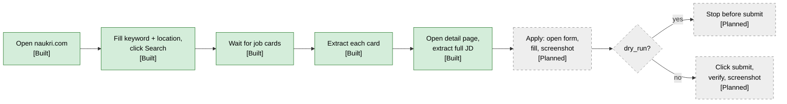
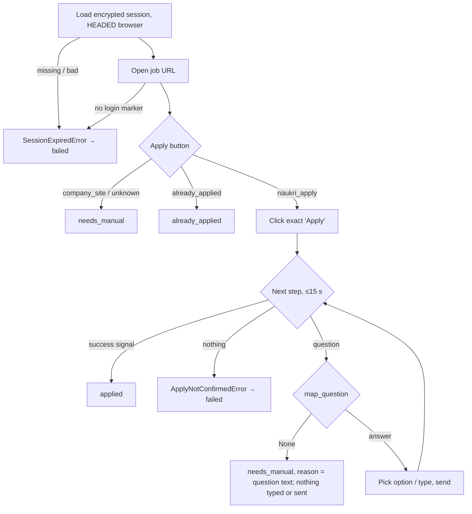

# 06 — Browser automation

Naukri has no public job-seeker API, so the system drives the website with the **Python Playwright
library** (async API, Chromium) running locally ([ADR-002](adr/ADR-002-playwright-for-naukri.md)).
Chromium is **headed by default** (`BROWSER_HEADLESS=false`) so the user can see what happens.

## Flow

### Current implementation (Built)

| Step | Code | Behaviour |
|---|---|---|
| Launch | `NaukriBrowser.start()` (`app/browser/naukri_browser.py`) | New Playwright, `chromium.launch(headless=...)`, new context every run, default timeout `BROWSER_TIMEOUT_MS` (20 s). With `logged_in=True` the context starts from the saved, decrypted session (see below). |
| Open | `open_naukri()` | `goto("https://www.naukri.com/")`. |
| Search | `search_jobs()` | Fill keyword + location inputs, click text "Search", `wait_for_selector(JOB_CARD)`. |
| Extract | `NaukriJobSource.get_jobs()` (`app/job_sources/naukri.py:30`) → `NaukriExtractor.extract_job()` | Iterates cards on the **first result page only**; per-card failures are logged (`job_extraction_failed`) and skipped. |
| No results | `naukri.py:53` | Timeout waiting for cards → `no_job_cards_found` warning, returns `[]`. |
| Close | `finally: browser.close()` | Always closes browser and Playwright. |

Search does not log in (results are public). Only the inspection tools below use a logged-in session.

## Selectors

Selectors live as constants / literals; they will break when Naukri changes its markup.

| Purpose | Selector | File |
|---|---|---|
| Keyword input | `input[placeholder="Enter skills / designations / companies"]` | `app/browser/naukri_browser.py:7` |
| Location input | `input[placeholder="Enter location"]` | `app/browser/naukri_browser.py:8` |
| Search button | `get_by_text("Search", exact=True)` | `app/browser/naukri_browser.py:40` |
| Job card | `.srp-jobtuple-wrapper` | `app/browser/naukri_browser.py:9` |
| Title / URL | `.title`, `a.title[href]` | `app/job_sources/naukri_extractor.py` |
| Company | `.comp-name` | same |
| Location | `.loc` | same |
| Experience (optional) | `.exp` | same |
| Description snippet | `.job-desc` | same |
| Skill tags | `.tags-gt .tag-li` | same |
| Detail-page JD + details | See [Job detail page](#job-detail-page-built) | `app/browser/naukri_selectors.py` |

## Job detail page (Built)

The search card only has a ~90-char snippet. `fetch_job_details` (activity, see
[03](03-workflows.md)) reads each job's detail page **after the keyword filter** — read only, no
clicks, **logged out** (public page; keeps this traffic away from the apply account).

| Step | Code | Behaviour |
|---|---|---|
| Fetch | `fetch_job_page()` (`app/job_sources/naukri_detail.py`) | New browser, `goto(url, wait_until="domcontentloaded")`, wait for `JOB_DETAIL_READY` (missing → logged, HTML still parsed), return `page.content()`. HTTP ≥ 400 → `DetailPageUnavailable` (retryable). |
| Parse | `parse_job_detail(html)` (`app/job_sources/naukri_detail_parser.py`) | Pure function, stdlib only. 1) schema.org `JobPosting` JSON-LD → JD + `JobDetails` (skills, salary, experience months, employment type, industry, department, role, education, date posted / valid through). 2) Fallback: text of the element whose class starts with `styles_JDC__dang-inner-html__` (JD only, `source="dom"`). 3) Else `DetailParseError`. A JD under 50 chars counts as missing, so an empty JD is never saved. |

| Selector | Value | Status |
|---|---|---|
| `JOB_POSTING_JSON_LD` + `JOB_POSTING_TYPE` | `script[type='application/ld+json']`, `@type == "JobPosting"` | Verified 2026-10-07 (`tests/fixtures/naukri/job_detail_{34,37,39}.html`) |
| `JOB_DESCRIPTION_CLASS_PREFIX` | `styles_JDC__dang-inner-html__` (CSS-module hash after it changes on deploys) | Verified 2026-10-07 (same fixtures) |

**Headless is blocked:** Naukri answers HTTP 403 "Access Denied" to headless Chromium (seen
2026-10-07); headed (`BROWSER_HEADLESS=false`, needs a display) gets 200.

**TLS inspection:** on a network whose firewall re-signs HTTPS (seen 2026-10-08: Sophos CA issuing
`*.naukri.com`), Chromium fails with `ERR_CERT_AUTHORITY_INVALID`. The code does not disable TLS
checks; the job then continues with the snippet. Fix on the network/OS side (done for the dev
network on 2026-10-08: issuer is GlobalSign again, see [known issue 17](12-roadmap-and-status.md#known-issues)).

Fixtures: `uv run python -m scripts.inspect_job_page <job_id>...` opens the pages (headed, delay
between pages) and writes trimmed fixtures (JSON-LD + JD section, ~9 KB instead of ~260 KB) to
`tests/fixtures/naukri/job_detail_<id>.html`, printing what the parser found.

### Apply-flow selectors (Built)

All apply-flow selectors (and the login marker) live in `app/browser/naukri_selectors.py`, each
marked **VERIFIED <date>** (seen in a saved live page) or **NOT VERIFIED**.

| Purpose | Selector | Status |
|---|---|---|
| Logged-in marker | `.nI-gNb-drawer__icon, .nI-gNb-icon-img, a[href*='/mnjuser/profile']` | Verified 2026-09-24 |
| Company-site button | `#company-site-button` | Verified 2026-09-24 (`tests/fixtures/naukri/company_site.html`) |
| Naukri apply button | `#apply-button` | Verified 2026-10-07 (`naukri_apply.html`) |
| Already applied | `#already-applied` (+ exact-text "Applied" fallback) | Not verified |
| Chatbot drawer, bot message, text input, radio labels, checkboxes, send | `.chatbot_DrawerContentWrapper …` | Not verified |
| Apply confirmation | `.acp-header-container .job-title-text:has-text('Applied to')` (Naukri redirects to an apply-confirmation page) | Verified 2026-10-07 (`apply_success.html`) |
| Apply confirmation (fallback) | header button turns "Applied" | Not verified |

A wrong unverified selector can only make the applier stop (`needs_manual`, or an error →
`failed`), never report a false `applied`. Verify them with `scripts/inspect_apply_flow.py` and add
sanitized samples to `tests/fixtures/naukri/`.

Planned hardening: move the search/card selectors above into `naukri_selectors.py` too.

## Session reuse via `storage_state` (Built)

Applying requires a logged-in Naukri account ([ADR-014](adr/ADR-014-encrypted-naukri-session.md)).

1. `scripts/naukri_login.py` first checks `NAUKRI_STATE_KEY` (`check_key()`), so a manual login is
   never wasted, then always opens a **headed** browser at `NAUKRI_LOGIN_URL`
   (`/nlogin/login`). The user logs in manually (including any OTP) and presses Enter in the
   terminal. The system never sees or stores the Naukri password.
2. `NaukriBrowser.is_logged_in()` waits up to 5 s for `LOGGED_IN_MARKER` (header avatar / profile
   link). Only if it is visible is `context.storage_state()` saved; otherwise nothing is written and
   the script exits 1.
3. `app/browser/session_store.py`: `save_state` / `load_state` encrypt with **Fernet** using
   `NAUKRI_STATE_KEY` into `NAUKRI_STATE_PATH` (default `secrets/naukri_state.enc`; folder `0700`,
   file `0600`). Missing key, missing file or wrong key raise `SessionStateError` with a message that
   contains no secret. Logs show only cookie count, domains and origin count.
4. `NaukriBrowser(logged_in=True)` creates the context with `new_context(storage_state=load_state())`.
5. Expiry: callers check `is_logged_in()`; if false, re-run `scripts/naukri_login.py`.
   *Planned:* a non-retryable `SessionExpired` activity error once apply runs inside Temporal.

`LOGGED_IN_MARKER` detected a real login on the first live run (2026-09-24).

## Apply-flow inspection (Built, no apply)

`scripts/inspect_apply_flow.py <job_id> [--click]` — a manual tool to learn / re-check the apply
markup. Without `--click` nothing is clicked.

- Loads the job URL from Postgres, opens it with the saved session, stops if the session expired.
- Saves `artifacts/inspect/<job_id>/01_job_page.html` + full-page `.png`.
- Reads `(id, text)` of every `APPLY_BUTTONS` match (`read_apply_buttons()`) and classifies them with
  `classify_apply_button()` (`app/browser/apply_button.py`): a known element id wins, else the exact
  text → `naukri_apply`, `company_site`, `already_applied` or `unknown`. Prints what it saw.
- `--click` acts **only** when the type is `naukri_apply` and after a `y/N` prompt: clicks the
  button whose text is exactly "Apply" / "Apply now" once, waits 5 s, saves `02_after_click.*`,
  then closes the browser. It never answers questions or clicks anything else.
- **Warning:** for a job without screening questions, that one click **is a real application**
  (seen live on 2026-10-07, job 23: Naukri went straight to the "Applied to …" page).
- Verified so far: `company_site`, `naukri_apply`, the apply confirmation; not yet: already-applied,
  chatbot ([Selectors](#apply-flow-selectors-built)).

## Rate limiting and delays

| Rule | Status |
|---|---|
| One detail page at a time: `fetch_job_details` runs on its own task queue `job-agent-browser` (`max_concurrent_activities=1`) | Built (`app/workflows/task_queues.py`, `worker.py`); discovery and apply still run on the main queue |
| Random 1–3 s pause between apply actions, per-key typing delay (80–200 ms) | Built (`job_applier.py`, `apply_page.py`) |
| Fixed delay before each detail page: `DETAIL_PAGE_DELAY_SECONDS` (3.0) | Built (`fetch_job_details`); jitter Planned |
| Max applications per day (`MAX_APPLIES_PER_DAY`, IST day) | Built ([03](03-workflows.md#apply-safety-rails-built)) |
| Max detail pages per run (e.g. 30) | Planned |
| Back off for hours on HTTP 429 / challenge pages; no retries against a CAPTCHA | Planned |
| Headed by default, real Chromium, no stealth plugins | Built (headed default); no-stealth is a rule |

## Screenshots and artifacts

*Built (local):* every live apply saves page HTML + full-page screenshot per step to
`artifacts/apply/<job_id>/<YYYYmmdd-HHMMSS>/NN_<step>.html|.png` (steps: `job_page`, `question`,
`success`, `nothing`, `error`). Folder is gitignored, created `0700`; a failed snapshot is logged and
never fails the apply. The inspection script writes to `artifacts/inspect/<job_id>/`.

*Planned:*
- Store in MinIO under `artifacts/{job_id}/{workflow_run_id}/{step}.png`
  ([ADR-013](adr/ADR-013-minio-artifacts.md)); keys recorded in `applications.artifact_keys`.
- Screenshots may contain PII (the candidate's filled form) — same retention rules as the resume.

## Failure handling

| Failure | Current | Planned |
|---|---|---|
| Search cards never appear | Warning, return `[]` | Same, plus screenshot; distinguish "no results" from "blocked". |
| One card fails to parse | Warning, skip card | Same, plus counter in `pipeline_runs`. |
| Browser crash / navigation timeout | Exception propagates, `main.py` aborts | Temporal activity retry (3×, backoff) with heartbeats. |
| Session expired | Apply: `SessionExpiredError` ("session expired … run scripts.naukri_login") → `failed` | Notify user. |
| CAPTCHA / bot challenge | n/a | Non-retryable `Blocked`, pause schedule, notify user. |
| Apply not confirmed (no question and no "applied" signal within 15 s) | `ApplyNotConfirmedError` → `failed`, never `applied`, never retried (1 attempt) | Same. |

## Live apply (Built; chatbot selectors not verified)

A job without screening questions is applied by the Apply click itself; the next step is the
confirmation page.

`app/browser/job_applier.py` defines the `JobApplier` protocol:
`apply(job_id, job, answers) -> ApplierResult(outcome, reason)` with outcome `applied`,
`needs_manual` or `already_applied`; raises on unexpected errors. `ApplyService` builds it through a
factory, so in `dry_run` it is never constructed ([03](03-workflows.md#apply-safety-rails-built)).

`NaukriJobApplier` holds the decisions; `NaukriApplyPage` (`app/browser/apply_page.py`) is the thin
Playwright side behind the `ApplyPage` protocol, so the decisions are tested with a fake page.

- Always headed (`BROWSER_HEADLESS` is ignored for apply): a human watches the first live runs.
- At most 15 questions, then `ApplyNotConfirmedError`.
- Naukri's chatbot asks one question at a time, so answers given **before** an unknown question
  were already sent to it; the application itself is not submitted.

### Question mapping (Built)

`map_question(Question, answers)` in `app/browser/apply_questions.py` is pure (no browser, no LLM):
fixed keyword rules for notice period, expected / current CTC, relocate, current location, years
per skill (`skill_years`) and total experience. It returns `None` (→ `needs_manual`) when:

- zero or more than one rule matches (e.g. "What is your CTC?", "expected vs current CTC");
- a value rule meets a yes/no question ("Are you serving notice?"), or the relocate rule meets a
  non-yes/no question ("Where would you relocate?");
- options are given but not exactly one fits the value, or option / question has no unit;
- the question is a checkbox (multi-select) question.

Free-text answers carry their unit unless the question names one: `30 days`, `14 LPA`
(`in lakhs` → `14`, `in INR` → `1400000`).

### Manual first run (Built)

`scripts/apply_one.py <job_id>` runs `ApplyService` in **live** mode for one job, without Temporal:
prints job, status and today's count, refuses unless status is `approved` / `failed` /
`needs_manual` (all only reachable after approval), and asks `y/N`. First run:
`MAX_APPLIES_PER_DAY=1 uv run python -m scripts.apply_one <job_id>`.

## Dry-run mode

- *Built:* `APPLY_MODE=dry_run` is the default; dry-run logs the apply and never opens a browser.
- *Planned:* dry-run executes the full apply flow up to the final submit click, captures screenshots, and
  records the application with `dry_run = true`.
- Switching to live applying is a deliberate config change, logged at startup with a warning.

## Headless mode

`BROWSER_HEADLESS=true` in `.env` runs Chromium headless (e.g. on a server). Headless is more likely
to be detected as automation; use it for discovery at most, and keep applying headed.
