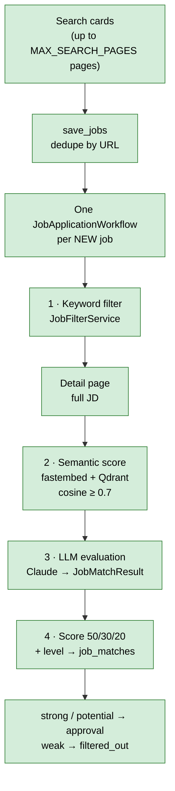

# 07 — Matching and retrieval

The matching funnel narrows many scraped jobs down to a few LLM evaluations. Each stage is cheaper
than the next.

All stages are **Built** and run per job inside `JobApplicationWorkflow` activities
([03](03-workflows.md)). The older batch pipeline (`JobMatchingPipeline`, top `MAX_MATCH_JOBS` per
run) was removed on 2026-10-16.

## Stage 0 — Candidate set

Only **new** jobs (first saved by this discovery run) get a workflow. A job that fails a stage ends
with `jobs.status = filtered_out` and is never re-processed. There is **no top-N cap**: every job
that passes the filter and the semantic threshold gets an LLM call
([known issue #12](12-roadmap-and-status.md#known-issues)). Jobs saved before the workflows existed
can be started by hand with `scripts/start_job_workflow.py`.

## Stage 1 — Keyword filter

`JobFilterService(search).filter_jobs` (`app/services/job_filter_service.py`). Every list comes
from the profile's `search:` section (`SearchConfig` in `app/models/candidate_profile.py`, required,
no code defaults; see `profile.example.yaml`). The `filter_job` activity loads the profile on each
call, so YAML edits apply without a worker restart.

| Rule | `search:` field |
|---|---|
| Drop if the title has | `exclude_title_keywords` (may be empty) |
| Keep if the title has | `title_keywords` |
| Else keep if the title has a `generic_titles` entry **and** a skill tag has | `supporting_skills` |

Matching is case-insensitive and **whole-word**: each keyword becomes `(?<!\w)<escaped>(?!\w)`,
compiled once in `__init__`. So `"rag"` no longer matches "sto**rag**e" and `"rest"` no longer
matches "inte**rest**", while "RAG-based", "c++" and "node.js" still match
(`tests/services/test_job_filter_service.py`).

Returns `(job, matched_keywords)` (deduplicated, in order); the pipeline currently discards
`matched_keywords`.

## Stage 2 — Semantic ranking (Qdrant)

`JobRanker.rank` (`app/services/job_ranker.py`) with `Embedder` and `JobVectorStore`.

| Setting | Value | Where |
|---|---|---|
| Embedding model | `BAAI/bge-small-en-v1.5` via fastembed (ONNX, CPU) | `app/vector/embedder.py:3` |
| Dimensions | 384 | `app/vector/job_vector_store.py:15` |
| Distance | Cosine | `job_vector_store.py:30` |
| Collection | `jobs_bge_small_v2` — **one collection per embedding model + embedded-text version** (v1: card snippet; v2: full JD when fetched). v1 is left in Qdrant for rollback | `job_vector_store.py` (`COLLECTION`) |
| Point ID | `jobs.id` from Postgres | `job_ranker.py:65` |
| Payload | title, company, location | `job_ranker.py:68` |
| Threshold | `MIN_SCORE = 0.7` | `job_ranker.py:10` |

Texts (`app/vector/texts.py`):

- Job: `title` + `"Skills: a, b, c"` + description truncated to 1500 chars. In the application
  workflow the description is the **full JD** (`fetch_job_details` runs before `semantic_score`,
  [03](03-workflows.md)); jobs without details fall back to the ~90-char card snippet.
- Profile: `"{experience_years} years of experience. Skills: {skills}."` — no target role, no education.

Steps:

1. `create_collection_if_missing()`.
2. Lazy sync: `find_missing_ids` → embed and upsert only jobs without a vector
   (`upsert_job_vectors` in `app/vector/job_sync.py`, the one function that writes job vectors; also
   used by `scripts/sync_jobs_to_qdrant.py` and the `embed_job` activity).
3. Embed the profile; `query_points` restricted to the candidate IDs (`HasIdCondition`), `limit=N`,
   `score_threshold=0.7`.
4. Map IDs back to jobs, preserving Qdrant order.

Changing the model: create a new collection name (e.g. `jobs_bge_base_v1`), backfill with
`scripts/sync_jobs_to_qdrant.py`, switch the constant, delete the old collection later. Never mix
vectors from two models in one collection.

Known limitations:

- `Embedder` and `QdrantClient` are synchronous; the `semantic_score` and `embed_job` activities run
  them in a thread (`asyncio.to_thread`), so the worker's event loop stays free.
- The 0.7 threshold is unvalidated. `scripts/search_jobs.py` uses 0.07, which suggests the value was
  being explored. Tune on the golden set ([05](05-agent-design.md#evals)).
- The Qdrant score is logged but not stored. Planned: `job_matches.semantic_score`.
- The lazy sync only adds missing vectors; it never updates one when a job's text changes. New jobs
  are fine (details are fetched before their first embedding). Jobs saved before detail fetching are
  fixed by `scripts/backfill_details.py` (fetch + `embed_job` overwrite, [03](03-workflows.md#detail-backfill-workflow-built));
  `scripts/sync_jobs_to_qdrant.py` overwrites every vector from Postgres.
- Full-JD texts score a bit higher than snippets (measured 2026-10-07 on 3 jobs: +0.01 to +0.06,
  e.g. 0.709 → 0.771), so more jobs may pass `MIN_SCORE` 0.7. Watch the shortlisted rate before
  tuning.

## Stage 3 — LLM evaluation

`JobMatchService.match` → `ClaudeCodeProvider.generate` → validated `JobMatchResult`. Calls are
**sequential**, with no timeout and no retry; failures skip the job. See [05](05-agent-design.md).

## Stage 4 — Score and level

`overall = round(0.5·skill + 0.3·role + 0.2·experience)`; level `strong ≥ 80`, `potential ≥ 60`,
else `weak`. Saved immediately per job via `save_match` (one commit per job).

## Stage 5 — Rank

`JobRankingService.rank` sorts by `(overall_score, skill_match, role_match, experience_match)`
descending. Used only by the `app/agent/` prototype; the workflows send each strong / potential job
to approval on its own, and `scripts/list_pending.py` lists them.

## Learned answers: related labels

The same embedding model also finds company-form answers I gave before for a **related** label
(`app/services/learned_answers.similar_answers`), e.g. "Total Experience" for "Years of
experience". It embeds the new label and every saved label (no Qdrant: the file is small), keeps
those with cosine ≥ `SIMILAR_MIN_SCORE` (0.70), one per distinct value, best 3. For a select or
radio, only answers that are one of its options count. Scores of right and wrong matches overlap
(2026-10-15: "current company" ~ "current employer" 0.85, ~ "previous company" 0.84), so these are
only candidates: I pick one in the fill review, nothing is filled from a score alone.

## Useful scripts

| Script | Purpose |
|---|---|
| `scripts/sync_jobs_to_qdrant.py` | Embed all Postgres jobs and overwrite their Qdrant vectors (rebuild). Reads through `JobRepository.get_all_jobs_with_ids`, so the **full JD** is embedded when fetched (before 2026-10-16 it read the raw `description` column, the snippet). |
| `scripts/backfill_details.py` | Fetch detail pages for jobs without details and re-embed them (`--dry-run`, `--limit`); see [03](03-workflows.md#detail-backfill-workflow-built). |
| `scripts/search_jobs.py [free text]` | Semantic search with the profile or a query, threshold 0.07, top 5. |
| `scripts/embedding_demo.py` | Stand-alone cosine similarity demo, no DB. |
| `scripts/check_unmatched.py` | Count unmatched jobs and saved matches. |
