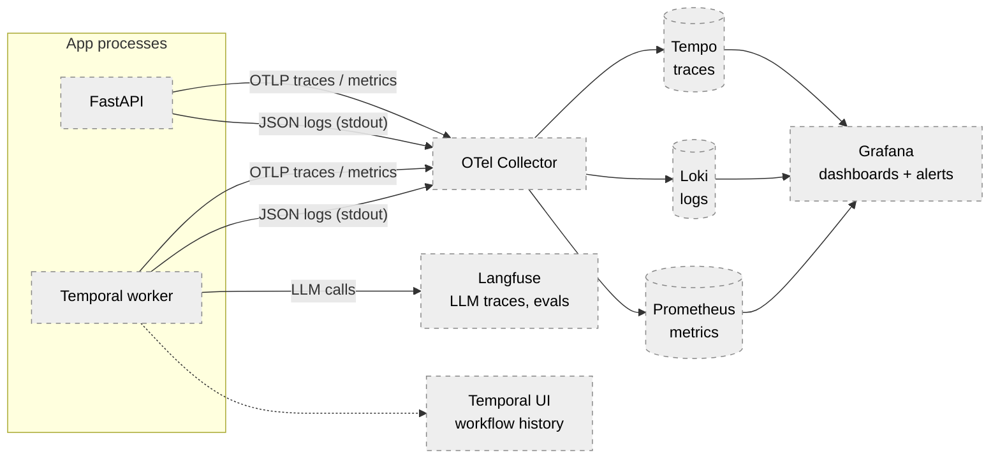
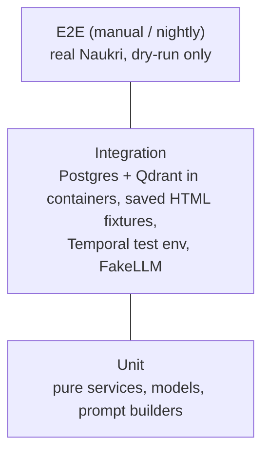

# 11 — Observability and testing

## Logging (Built)

`app/logging_config.py` configures structlog on top of stdlib logging:

- Output: stdout. `LOG_FORMAT=console` (coloured, dev) or `json` (one object per line).
- Every event has `timestamp` (ISO), `level`, `logger`, `event`; context via `logger.bind(...)` and contextvars.
- `app.*` loggers use `LOG_LEVEL`; the root logger (third-party) is fixed at `WARNING`.
- Convention: event names are `snake_case` past-tense facts (`jobs_saved`), fields are key-value.

### Current events

| Event | Level | Logger / file | Fields |
|---|---|---|---|
| `profile_loaded` | info | `main.py`, `app/agent/agent.py` | `name` ⚠ PII, `skills` (count) |
| `search_started` | info | `app/job_sources/naukri.py` | `keyword`, `location` |
| `no_job_cards_found` | warning | naukri.py | `timeout_ms`, `url` |
| `job_cards_found` | info | naukri.py | `count`, `search_duration_ms` |
| `job_extracted` | debug | naukri.py | `index`, `total`, `title`, `experience`, `skills` |
| `job_extraction_failed` | warning | naukri.py | `index`, `total`, `exc_info` |
| `jobs_extracted` | info | naukri.py | `count` |
| `jobs_discovered` | info | `job_matching_pipeline.py` | `count` |
| `job_without_url_skipped` | warning | `job_repository.py` | `title` |
| `jobs_saved` | info | job_repository.py | `received`, `unique`, `new`, `already_seen` |
| `unmatched_jobs_loaded` | info | job_repository.py | `count`, `max_age_days` |
| `jobs_filtered` | info | pipeline | `count` |
| `qdrant_collection_created` | info | `job_vector_store.py` | `collection` |
| `job_vectors_upserted` | info | job_vector_store.py | `count` |
| `jobs_ranked` | info | `job_ranker.py` | `candidates`, `selected`, `min_score`, `top` |
| `matching_started` | info | pipeline | `job_title`, `company`, `index`, `total` |
| `matching_failed` | warning | pipeline | `job_title`, `company`, `exc_info` |
| `matching_finished` | info | pipeline | `job_title`, `company`, `overall_score`, `match_level` |
| `match_saved` | info | job_repository.py | `job_id`, `overall_score` |
| `job_search_started` | info | `app/agent/claude_tools.py` | `keyword`, `location` |
| `agent_message_received` | debug | `app/agent/agent.py` | `message` (full SDK message) |
| `job_not_selected` | info | agent.py | — |

Gaps: no run ID tying a run's events together, no LLM latency/token fields, no durations for
filter/rank stages, `print()` used for final output in `main.py`.

## Target observability (Planned)

| Piece | Purpose | Notes |
|---|---|---|
| OpenTelemetry SDK | Traces for each activity, DB call, Qdrant call, Playwright step | `temporalio.contrib.opentelemetry` interceptor; SQLAlchemy + httpx auto-instrumentation. |
| structlog + trace IDs | Correlate logs with traces | Add `trace_id`/`span_id` processor; add `run_id`/`workflow_id` via contextvars. |
| Prometheus metrics | Counters/histograms | `jobs_discovered_total`, `jobs_new_total`, `llm_calls_total{provider,outcome}`, `llm_latency_seconds`, `browser_failures_total{kind}`, `approvals_pending`. |
| Grafana | Dashboards + alerts | Alerts: discovery failed twice in a row, `Blocked` errors, approvals pending > timeout/2. |
| Langfuse | Per-LLM-call trace: prompt version, model, input/output, latency, validation result | Self-hosted; profile PII minimised first ([10](10-security.md)). |
| Temporal UI | Workflow history, pending signals | Comes with Temporal. |

## Testing

### Test pyramid (target)

| Level | Scope | Status |
|---|---|---|
| Unit | Scoring, levels, schema bounds, profile loading | **Built** (21 tests) |
| Unit | Filter rules, text builders, ranking sort, prompt rendering | Planned |
| Integration | `JobRepository` against real Postgres (dedupe, unmatched query, save_match) | Planned |
| Integration | `JobRanker` against real Qdrant with a stub embedder | Planned |
| Integration | `NaukriExtractor` against saved HTML via `page.set_content()` | Planned |
| Integration | Temporal workflows with `WorkflowEnvironment.start_time_skipping()` (approval timeout, signals, no-submit-without-approval) | Planned |
| Contract | `ClaudeAgentSDKProvider` / `OllamaProvider` return valid `JobMatchResult` (marked, opt-in) | Planned |
| E2E | Full run against Naukri in dry-run | Manual only |
| Evals | LLM quality ([05](05-agent-design.md#evals)) | Planned |

### Current tests

`uv run pytest` — config in `pyproject.toml` (`testpaths = ["tests"]`, `pythonpath = ["."]`). All synchronous;
no `pytest-asyncio`, no coverage tool.

| File | Tests | Covers |
|---|---|---|
| `tests/models/test_job_match.py` | 7 | `JobMatchResult` accepts 0-100, rejects -1 and 101 for each score |
| `tests/services/test_job_score_service.py` | 6 | 50/30/20 weights, 0 and 100 edges, rounding case (80/90/70 → 81) |
| `tests/services/test_job_match_level_service.py` | 5 | Boundaries 59/60/79/80/100 |
| `tests/services/test_profile_loader.py` | 3 | Example profile loads, missing file message, negative experience rejected |

### Coverage by module (qualitative)

| Module | Tested? |
|---|---|
| `app/models/job_match.py` | Yes |
| `app/services/job_score_service.py`, `job_match_level_service.py`, `profile_loader.py` | Yes |
| `app/services/job_filter_service.py`, `job_ranking_service.py`, `app/vector/texts.py` | No (pure, easy wins) |
| `app/db/job_repository.py` | No |
| `app/services/job_ranker.py`, `app/vector/*` | No |
| `app/job_sources/*`, `app/browser/*` | No |
| `app/services/job_matching_pipeline.py`, `job_match_service.py`, `app/llm/*` | No |
| `app/agent/*` | No |

## CI plan (Planned — GitHub Actions)

Workflow on every PR and push to `main`:

1. `uv sync --locked` (fails if `uv.lock` is stale — would have caught the undeclared SDK dependency
   once imports are checked).
2. Lint + format check: `ruff check`, `ruff format --check`.
3. Type check: `mypy app` (or `pyright`) — would catch the wrong return type in `ClaudeCodeProvider`.
4. Secret scan: `gitleaks`.
5. Unit tests: `pytest -m "not integration"` with `pytest-cov`, report coverage.
6. Integration job: service containers `postgres:16` and `qdrant/qdrant:v1.18.2`;
   `alembic upgrade head`, `alembic check`, `pytest -m integration`.
7. Import smoke test: `python -c "import main, app.agent.agent"` to catch missing dependencies.

Not in CI: anything that touches naukri.com or calls Claude (no real accounts in CI).
